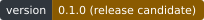
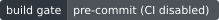
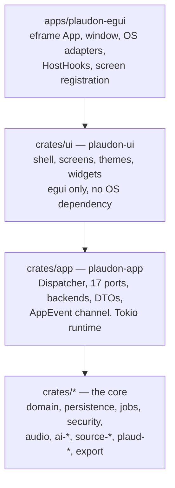

<h1 align="center">
  
</h1>

<p align="center">
  A local-first desktop application for importing, transcribing and reviewing your own recordings —
  native Rust, bring your own keys.
</p>

<p align="center">
  <a href="LICENSE"></a>
  <a href="docs/public/release-notes.md"></a>
  <a href="#status-and-limitations"></a>
  <a href="rust-toolchain.toml"></a>
  <a href="docs/public/privacy-disclosure.md"></a>
  <a href="docs/PRECOMMIT.md"></a>
  <a href="docs/public/release-notes.md#release-artifacts-and-verification"></a>
</p>

<p align="center">
  
</p>

---

<!-- BEGIN: macOS unsigned-build install (docs/public/install-macos.md) -->

## Install and open Plaudon on macOS (unsigned build)

The macOS artifact is **ad-hoc signed and not notarized**: there is no Apple
Developer ID certificate and no notarization ticket behind this project, so macOS
blocks the first launch. On current macOS the old right-click → **Open** trick is
gone; the steps below are the only two routes. Full version with screenshots:
[`docs/public/install-macos.md`](docs/public/install-macos.md).

1. **Download** `Plaudon-<version>-macos-arm64.zip` and `checksums.txt` from the
   [latest release](https://github.com/spdrman/plaudon/releases/latest).
2. **Verify the download** (run it in the folder holding both files):
   ```sh
   shasum -a 256 -c checksums.txt --ignore-missing
   # ./Plaudon-<version>-macos-arm64.zip: OK
   ```
   Anything but `OK` means you do not have the published bytes — stop there.
3. **Install:** `unzip Plaudon-<version>-macos-arm64.zip && mv Plaudon.app /Applications/`
4. **Open it once and let it be blocked.** macOS shows *"Plaudon.app" Not Opened —
   Apple could not verify "Plaudon.app" is free of malware…*. Click **Done**, not
   *Move to Trash*. That blocked attempt is what creates the entry in the next step.
5. **Allow it:** **System Settings → Privacy & Security → Security**, where
   *"Plaudon.app" was blocked to protect your Mac* now has an **Open Anyway**
   button. Click it, authenticate with your password or Touch ID, and confirm.
   Leave *Allow applications from* on **App Store & Known Developers**.

   Terminal alternative, same effect — removes the quarantine flag the browser
   attached to the download:
   ```sh
   xattr -dr com.apple.quarantine /Applications/Plaudon.app
   ```

You are overriding a security control to run a build nobody but its authors has
checked. Do it only if you trust this build, and only after the checksum matched;
building from source ([Build and run](#build-and-run)) avoids the question. The
no-warranty terms in [No warranty / use at your own risk](#no-warranty--use-at-your-own-risk)
apply in full. Intel Macs are not covered — the release is Apple Silicon only, and
the Windows `.msi` is unsigned too (SmartScreen warns) and has never been run on
Windows.

<!-- END: macOS unsigned-build install -->

---

## What Plaudon is

Plaudon is an independent, local-first desktop application for importing, transcribing and reviewing
your own recordings. It is not produced by, affiliated with or approved by PLAUD, OpenRouter or
Apple.

* **Local-first.** Your recordings, transcripts and summaries live in a library on your own disk.
  Local-only Mode is on from the first launch, and in that state the application makes no
  app-initiated network request at all.
* **Bring your own key.** There is no account, no subscription and no server component of ours.
  Cloud AI is opt-in and runs against *your* OpenRouter key under a consent grant scoped to a
  purpose and a content type.
* **Native Rust.** The desktop shell is [egui](https://github.com/emilk/egui)/eframe
  (`apps/plaudon-egui`); everything underneath it — persistence, the job engine, the AI adapters,
  the security gate — is Rust in this workspace. No web view, no bundled browser, no daemon and no
  listening socket, and no node, npm, vite or Playwright anywhere in the build or the test suite.
* **Evidence-gated.** Nothing claims to work on hardware nobody has run it on. Device, cloud and
  platform support is published from a machine-readable claim register
  ([`docs/public/compatibility.md`](docs/public/compatibility.md)), and a cell without archived
  evidence reads `Unsupported` rather than "should work".

---

## Features

The status of each row is the one recorded in
[`docs/EGUI_MIGRATION_PLAN.md`](docs/EGUI_MIGRATION_PLAN.md) §4, where `done` means the behaviour is
reachable in the built application and covered by a test. Rows that are conditional, experimental or
short of their full design say so here.

### Library and import

* Import audio with the file picker or by dropping files onto the window. An import **copies**; it
  never moves, modifies or deletes your file.
* Content-addressed archive with a durable import journal, so re-importing the same bytes is
  detected as a duplicate rather than silently doubling your library.
* Virtualized recording table — sort, filter by import/transcription status, source, tag and date,
  bulk selection, context menus, keyset paging — measured against a 10,000-row library.
* Cross-recording search, an Inbox for newly arrived items, and watched folders with a
  completion barrier so a half-written file is never imported.
* A duration that was never measured renders as `Unknown`, never as `0:00`.

### Player and transcript

* Playback with a waveform painted from a multiresolution peak pyramid computed in Rust, click-to-seek,
  timeline zoom, speaker regions, speed (0.5×–2×) and volume. Opus is decoded by a pure-Rust decoder.
* Transcript editor over a stable-id document model: undo/redo, find **and** replace, autosave into
  immutable revisions, conflict refusal when the stored revision moved underneath you, and a
  revision history that keeps every earlier revision retrievable.
* Speaker identity is editable **per cluster only**. Per-segment speaker reassignment is not built.

### Transcription and meeting intelligence

* **Local transcription** with whisper.cpp (`crates/ai-whisper`), with runtime backend selection,
  resource preflight and cooperative cancellation. It is behind the `local-whisper` build feature,
  which is off by default because it compiles whisper.cpp; with it off the transcribe executor
  reports the engine as unavailable in this build rather than pretending. Model weights are downloaded by you, from the
  publisher you choose, with the licence shown first
  ([`docs/public/model-licensing.md`](docs/public/model-licensing.md)).
* **Apple Speech and Foundation Models — conditional.** Reachable only in a build made with the
  optional `apple-bridge` feature, on macOS 26 or newer, on Apple Silicon with Apple Intelligence
  enabled. Availability is probed at run time and never assumed; an unavailable Apple engine falls
  back to whisper.cpp and **never** to a cloud engine. Measured on one host (Apple M5, macOS 27.0.1,
  [`docs/benchmarks/apple-native-ai.md`](docs/benchmarks/apple-native-ai.md)); the
  "Apple Intelligence disabled" and "ineligible hardware" cases are not measured on hardware.
* **Cloud AI — opt-in, BYOK, one gateway.** OpenRouter only, with your own key, and only after a
  probe has observed a real exchange and resolved a privacy route for that exact endpoint
  ([ADR-0002](docs/adr/ADR-0002-openrouter-is-the-only-cloud-ai-gateway-in-v1.md)). An API key is
  never read as consent. The advertised price is shown before dispatch and the provider-reported
  usage after; an unknown price is shown as unknown, never as zero. Per-job and monthly budget caps
  stop a run locally.
* **Grounded outputs.** Summaries, decisions, action items, risks, questions and topics are emitted
  as *claims*, each carrying source anchors into the transcript. An anchor states whether it
  resolved, and against a transcript with alignment it offers "Seek to this passage" — against one
  without, it says there is no playback position rather than inventing a time
  ([ADR-0041](docs/adr/ADR-0041-an-anchor-proves-traceability-not-truth.md)).
* Ask-a-recording chat and study artifacts, and a template manager for the extraction prompts. Live
  runs are gated on text-model capability verification.

### Jobs, export and backup

* Durable job engine: persisted state machine, idempotency, checkpoints, cancellation and crash
  recovery; a job list with progress, an activity history and native notifications.
* Export to plain text, Markdown, JSON, SubRip and WebVTT. Caption formats are **disabled**, with
  the reason stated, for a revision that carries no alignment.
* Portable backup and restore, optionally encrypted (Argon2id + XChaCha20-Poly1305), with the
  plaintext-versus-encrypted difference disclosed and the archive inspectable before a restore.
* Deletion disclosure with a confirmation token, and tombstones, so you can see exactly what a
  deletion does and does not reach.

### Devices and sources

* **Direct PLAUD device import over Bluetooth — implemented, published `Unsupported`.** The frame
  codec, the read-only opcode allowlist, the gate policy and the whole screen exist and are unit
  tested, but **no hardware, firmware and host-OS combination has an archived evidence record**, so
  every direct-device route is published as `Unsupported` and is not offered. The real radio is
  behind the optional `hardware-scan` build feature; with it off the screen reports
  `UnavailableInBuild`, which is the honest state and not "no devices". An unlisted device can be
  probed read-only through a one-shot *experimental probe* grant bound to that peripheral.
  See [`docs/public/compatibility.md`](docs/public/compatibility.md).
* **USB import — blocked.** No device command exists for a mounted legacy volume; the screen offers
  ordinary import of the mounted files and says why.
* **PLAUD Cloud CLI connector — `Unsupported`.** The adapter is versioned and fails closed: the
  committed compatibility table is empty, so any real CLI resolves to `IncompatibleVersion`.
* A setup wizard with exactly three honest options: direct device, account, or files.

### Shell

* Six destinations — Library, Inbox, Jobs, Templates, Settings, Devices — reachable by `Mod+1..6`,
  by Tab alone, and from a command palette over one command registry.
* Four themes (light, dark, high-contrast light, high-contrast dark) over a 20-role colour system,
  remappable shortcuts, resizable panes, persisted window state, a tray icon, a native macOS
  application menu, and `.plaudon` / `plaudon://` associations registered by the installers.
* Accessibility is asserted automatically through the AccessKit tree (roles, names, focus order).
  **No VoiceOver or Narrator run has been performed** — see [Status and limitations](#status-and-limitations).

---

## Privacy and security model

The normative documents are [`docs/public/privacy-disclosure.md`](docs/public/privacy-disclosure.md)
and [`docs/threat-model/README.md`](docs/threat-model/README.md). In summary:

| | |
| --- | --- |
| **Local-only Mode** | On at first launch. In that state the application performs no app-initiated network request at all: no update check, no model download, no telemetry, no account login, no cloud inference. It is enforced in Rust at the single egress gate ([ADR-0013](docs/adr/ADR-0013-single-egress-gate.md)), not by a badge. It covers traffic *this* process initiates — it says nothing about your OS, your browser or a cloud-sync client acting on a folder you chose. |
| **Consent** | Scoped, not a global switch: a grant covers a purpose, a content type (audio bytes, or transcript text), a provider or model set, retention and routing constraints, and the version of the disclosure you agreed to. Revoking or expiring a grant fails the next dispatch check. Revocation is recorded; it is never claimed to recall what was already sent. |
| **Credentials** | Your OpenRouter key goes to the macOS Keychain or the Windows Credential Manager, is handed over once, and its presence — never its value — is reported back. There is no plaintext fallback ([ADR-0014](docs/adr/ADR-0014-no-plaintext-credential-fallback.md)); a locked vault is reported as locked. |
| **No service** | No daemon, no listening socket, no account system of ours, no telemetry ([ADR-0007](docs/adr/ADR-0007-no-service-backend-no-daemon-no-listening-socket.md)). |
| **Originals** | An import never deletes or modifies the source ([ADR-0010](docs/adr/ADR-0010-an-import-never-deletes-or-modifies-the-source.md)); originals are immutable and derived outputs are versioned ([ADR-0006](docs/adr/ADR-0006-immutable-originals-versioned-derived-outputs.md)). |
| **At rest** | The library and a plaintext portable backup are **not** encrypted. Use your operating system's full-disk encryption. Encrypted portable backups are available; see [`docs/public/backup-and-restore.md`](docs/public/backup-and-restore.md) and [ADR-0402](docs/adr/ADR-0402-full-library-encryption-evaluation.md). |
| **Bluetooth** | The legacy PLAUD protocol may exchange a static per-device credential over a link that is not encrypted at the radio layer. Disabling every internet connection does not make that link private. |
| **Not guaranteed** | The threat model states its own limits, and open findings are tracked in [`docs/threat-model/open-findings.md`](docs/threat-model/open-findings.md). |

---

## No warranty / use at your own risk

Plaudon is free and open-source software, licensed under the **MIT License** and provided
**"AS IS", without warranty of any kind**, express or implied. That disclaimer is not a
formality: the project makes **no guarantee of legal compliance** of any sort, and the authors
and contributors accept no liability for how the software is used.

* **Recording and consent are your responsibility.** Laws on recording conversations, on
  processing voice as biometric data (BIPA, CUBI, Washington's My Health My Data, GDPR Art. 9
  and their equivalents elsewhere), and on retaining such data differ by jurisdiction and change
  over time. Determining which of them apply to you, obtaining whatever consent they require from
  the people you record, and honouring their rights is yours to do — the software cannot do it
  for you and does not claim to.
* **No legal review gates this project**, and nothing in this repository is legal advice. Where
  the documentation discusses statutes or case law it is engineering context with its sources
  cited and its uncertainties marked `CONTESTED`; the owner has accepted that uncertainty rather
  than resolving it, and the no-warranty terms above are the reason that is possible.
* **The voice-profile (speaker-recognition) feature is off by default**, is additionally absent
  from default builds, is local-only, and requires an explicit consent gate before it will
  compute anything. Voiceprints never leave your machine and are never sent to us. These are
  engineering safeguards, not a compliance claim.
* The retention, deletion and disclosure behaviour the product does implement is described in
  [`docs/public/privacy-disclosure.md`](docs/public/privacy-disclosure.md), and the threat model
  states its own limits in [`docs/threat-model/open-findings.md`](docs/threat-model/open-findings.md).

---

## Requirements

| | |
| --- | --- |
| **Toolchain** | Rust as pinned by [`rust-toolchain.toml`](rust-toolchain.toml) (`rustup show` reads it). The workspace is edition 2021 with `rust-version = "1.90"`. |
| **macOS** | Xcode Command Line Tools (`codesign`, `iconutil`, `sips`, `plutil`, `PlistBuddy`). For `whisper-rs`, export the SDK path and *then, separately*, the C++ header flag: `export SDKROOT=$(xcrun --show-sdk-path)` followed by `export CXXFLAGS="-isystem $SDKROOT/usr/include/c++/v1"`. |
| **Windows** | The Windows SDK resource compiler (`rc.exe`) or LLVM's `llvm-rc` on `PATH`; the WiX toolset for the `.msi` (`dotnet tool install --global wix --version 5.0.2`). |
| **Linux** | `libdbus-1-dev` (AccessKit's AT-SPI adapter and the secret-service keyring backend) and `libasound2-dev` (cpal). Linux is a build and test target here, not a published one. |

**Resource policy.** A workstation runs **one** cargo process at `-j 2`, scoped with `-p`. Anything
workspace-wide, anything touching `whisper-rs`, and every snapshot or performance run goes through
[`scripts/e2e-remote.sh`](scripts/e2e-remote.sh).

---

## Build and run

```sh
# debug, for development
cargo build -j 2 -p plaudon-egui
cargo run   -j 2 -p plaudon-egui

# release, which is what the packages contain
export SDKROOT=$(xcrun --show-sdk-path)
export CXXFLAGS="-isystem $SDKROOT/usr/include/c++/v1"
cargo build -j 2 --release -p plaudon-egui
```

Optional features. All are off by default, and the defaults produce a working application that
reports what it cannot do instead of pretending:

| Feature | Effect | Cost |
| --- | --- | --- |
| `apple-bridge` | links the Swift bridge, so Apple Speech and Foundation Models are reachable | needs [`scripts/build-apple-bridge.sh`](scripts/build-apple-bridge.sh) and Xcode; macOS only |
| `local-whisper` | links the local whisper.cpp speech engine | compiles whisper.cpp; a release bundle is expected to turn it on |
| `hardware-scan` | links the real Bluetooth radio (`btleplug`) | the build then touches a radio at run time; CI never enables it |
| `cpal-output` | the `cpal` device backend of `plaudon-audio-playback` | enabled by the binary; `crates/ui` deliberately does not, so the widgets and the kittest suite build in a container with no audio stack |

```sh
cargo build -j 2 --release -p plaudon-egui --features "apple-bridge,local-whisper"
```

### Running against another library

`PLAUDON_DATA_DIR` replaces the data directory for one run — database, media archive, `logs/`,
`peak-cache/` and `shell-state.json` all follow it, so the installed library is untouched. It must
be an absolute path; an empty or relative value is refused with a typed error rather than guessed
at.

```sh
PLAUDON_DATA_DIR=/tmp/plaudon-smoke cargo run -j 2 -p plaudon-egui
```

### Package

```sh
# macOS (arm64 .app + .zip + a signing report) — dist/macos-egui/
scripts/package-macos-egui.sh
scripts/package-macos-egui.sh --features apple-bridge

# Windows (x64 .msi + a signing report) — dist/windows-egui/
pwsh scripts/package-windows-egui.ps1
```

**Signing status, stated honestly.** With no credentials configured, `scripts/package-macos-egui.sh`
produces an **ad-hoc signed, un-notarized** bundle and exits **3**, which means "built and
verifiable, **not** publishable"; the report records `signature: adhoc_verified` and
`notarization: not_verified`. A Developer ID identity alone gets a verified signature and still
exits 3. Only an identity *plus* a notarization profile exits 0. The Windows script behaves the same
way: unsigned is exit 3. Neither script ever prints "signed" for an unsigned artifact or "notarized"
for one that was not submitted. **No signed or notarized release has been produced from this
repository.** See [`docs/EGUI_BUILD.md`](docs/EGUI_BUILD.md) §5–§6.

### Release

A release is cut by moving `main` onto the `release` branch; everything after that push is
`.github/workflows/release.yml`:

```sh
git push origin main:release
```

It builds `Plaudon.app.zip` on macOS and the per-user `.msi` on Windows, smoke-tests both, creates
the tag `v<workspace version>` at the released commit, drafts a GitHub release with the artifacts,
their SHA-256 sums and both signing reports, and then merges `release` back into `main` through a
pull request. Without signing credentials the release is a draft **prerelease** whose assets are
labelled `UNSIGNED / NOT NOTARIZED — development build`; nothing is ever described as signed or
notarized on the strength of a report that does not say so. `workflow_dispatch` builds the same
artifacts and creates no tag and no release. See [`docs/EGUI_BUILD.md`](docs/EGUI_BUILD.md) §9.

---

## Testing

All UI, end-to-end and visual tests are `egui_kittest` through `cargo test` — no vitest, no
Playwright ([`docs/EGUI_TESTING.md`](docs/EGUI_TESTING.md) §1).

```sh
# the shell, its screens, the harness, the platform adapters and the vendored widgets
cargo test -j 2 -p plaudon-egui -p plaudon-ui -p plaudon-ui-testkit -p plaudon-platform -p plaudon-craft-ui

# the application layer
cargo test -p plaudon-app

# the packaging inputs (identifier, entitlements, registry claims, icons, manifest)
cargo test -j 2 -p plaudon-egui --test packaging
```

Anything that drives a real renderer runs in a disposable Docker container with a software Vulkan
adapter (mesa/lavapipe), never on a workstation. [`scripts/e2e-remote.sh`](scripts/e2e-remote.sh)
picks a remote Linux runner when one is reachable and not busy, and otherwise falls back to local
Docker with the same container recipe. `PLAUDON_E2E_HOST` chooses: `auto` (the default), `local`,
or any ssh destination of your own.

```sh
# the whole end-to-end suite, remotely
scripts/e2e-remote.sh cargo test -p plaudon-egui --test e2e_flows

# pixel comparison against the committed baselines; a baseline produced anywhere else is not valid
PLAUDON_E2E_APT_PACKAGES=libdbus-1-dev scripts/e2e-remote.sh shell \
  'PLAUDON_VISUAL=1 cargo test -p plaudon-egui --test spike_kittest'

# regenerate the demo at the top of this file
scripts/make-demo-gif.sh

# redraw the status chips at the top of this file (--check fails if one is stale)
python3 scripts/make-readme-badges.py
```

Artifacts land in `target/e2e-results`. `PLAUDON_E2E_HOST=local` forces the local container.

Two suites never run by themselves, because they need something only you can provide. Both are
`#[ignore]` *and* gated on an environment variable, so neither a plain `cargo test` nor
`cargo test -- --ignored` can start them by accident.

```sh
# the official PLAUD CLI you installed, against your own account: it reads, it never signs you
# in or out, and it imports into a throwaway library rather than your real one
PLAUDON_PLAUD_CLI_TESTS=1 cargo test -p plaudon-app --test plaud_real_cli -- --ignored --nocapture
```

Real PLAUD hardware has its own runner and its own evidence record; see
[`docs/hardware/macos-apple-silicon.md`](docs/hardware/macos-apple-silicon.md).

---

## Architecture

Four layers, one direction; no arrow points back up.



A view mints an `AppCommand`; `Dispatcher::send` returns a `CommandId` immediately and the work runs
on the Tokio runtime; the answer arrives as an `AppEvent` on a bounded, coalescing channel that the
render loop drains at the top of the next frame. **Events never carry state** — they say what
changed, and the view refetches. Errors are values, not panics. Nothing reaches the application
except through the dispatcher.

[`docs/EGUI_ARCHITECTURE.md`](docs/EGUI_ARCHITECTURE.md) has the full picture, including the thread
model and how to add a screen.

### Crate map

| Crate | Path | What it is |
| --- | --- | --- |
| `plaudon-egui` | [`apps/plaudon-egui`](apps/plaudon-egui) | The binary: eframe app, window, OS adapters, host hooks, packaging inputs |
| `plaudon-ui` | [`crates/ui`](crates/ui) | egui shell and every screen; thin — the rules it renders live in core crates |
| `plaudon-ui-testkit` | [`crates/ui-testkit`](crates/ui-testkit) | The deterministic `egui_kittest` harness, the accessibility view and the snapshot policy |
| `plaudon-craft-ui` | [`third_party/craft-ui`](third_party/craft-ui) | Vendored split geometry and accessible resize handle (see [NOTICE](NOTICE)) |
| `plaudon-app` | [`crates/app`](crates/app) | Ports, validated commands, the typed command/event boundary and the owned Tokio runtime |
| `plaudon-app-core` | [`crates/app-core`](crates/app-core) | Use cases and policies over the domain model (import, deduplication) |
| `plaudon-domain` | [`crates/domain`](crates/domain) | Identities, media identity, transcripts, capability and error taxonomy |
| `plaudon-persistence` | [`crates/persistence`](crates/persistence) | SQLite migrations, repositories and the content-addressed media archive |
| `plaudon-jobs` | [`crates/jobs`](crates/jobs) | Persisted job orchestration: state machine, idempotency, checkpoints, crash recovery |
| `plaudon-security` | [`crates/security`](crates/security) | Key access, consent policy, the egress gate, path guard and sandboxing |
| `plaudon-transcript-doc` | [`crates/transcript-doc`](crates/transcript-doc) | The UI-independent transcript document: stable ids, undo log, search/replace, autosave |
| `plaudon-audio` | [`crates/audio`](crates/audio) | Media validation, streaming decode to canonical PCM, chunk planning |
| `plaudon-audio-playback` | [`crates/audio-playback`](crates/audio-playback) | Integer playback time, the mixer and output, and the waveform peak pyramid |
| `plaudon-ai-contracts` | [`crates/ai-contracts`](crates/ai-contracts) | The capability contracts every AI adapter implements |
| `plaudon-ai-whisper` | [`crates/ai-whisper`](crates/ai-whisper) | whisper.cpp adapter with backend selection, preflight and cancellation |
| `plaudon-ai-apple` | [`crates/ai-apple`](crates/ai-apple) | macOS-only Apple speech and language bridge bindings |
| `plaudon-ai-openrouter` | [`crates/ai-openrouter`](crates/ai-openrouter) | OpenRouter client: typed request families, catalogue records, error classification |
| `plaudon-ai-local-llm` | [`crates/ai-local-llm`](crates/ai-local-llm) | Local text generation behind the footprint and licence gate |
| `plaudon-ai-tools` | [`crates/ai-tools`](crates/ai-tools) | Versioned grounded question-answering and learning artifacts |
| `plaudon-ai-diarization` | [`crates/ai-diarization`](crates/ai-diarization) | The validated local diarization plugin contract |
| `plaudon-recording-sources` | [`crates/recording-sources`](crates/recording-sources) | Generic recording-source and direct-device capability contracts |
| `plaudon-source-folder` | [`crates/source-folder`](crates/source-folder) | Watched folders with stable-file completion barriers |
| `plaudon-source-plaud-cli` | [`crates/source-plaud-cli`](crates/source-plaud-cli) | Versioned adapter for the official PLAUD Cloud CLI; no private API use |
| `plaudon-source-plaud-device` | [`crates/source-plaud-device`](crates/source-plaud-device) | Device capability registry and read-only transfer orchestration |
| `plaudon-plaud-protocol` | [`crates/plaud-protocol`](crates/plaud-protocol) | Validated legacy frames and codecs with a static read-only opcode allowlist |
| `plaudon-plaud-ble` | [`crates/plaud-ble`](crates/plaud-ble) | BLE central transport: read-only discovery policy, opt-in hardware scanner |
| `plaudon-plaud-usb` | [`crates/plaud-usb`](crates/plaud-usb) | Read-only scan of a genuinely mounted legacy volume |
| `plaudon-plaud-wifi` | [`crates/plaud-wifi`](crates/plaud-wifi) | Reserved transport, gated off until protocol validation |
| `plaudon-platform` | [`crates/platform`](crates/platform) | Dialogs, clipboard, OS theme, opener, tray model, associations, deep links |
| `plaudon-export` | [`crates/export`](crates/export) | Transcript, caption and portable archive export |
| `plaudon-notifications` | [`crates/notifications`](crates/notifications) | Native macOS and Windows notifications |
| `plaudon-updater` | [`crates/updater`](crates/updater) | Signed update manifest verification, crash-safe install, verified rollback |
| `plaudon-diagnostics` | [`crates/diagnostics`](crates/diagnostics) | Structured diagnostics and redacted logs |
| `plaudon-automation` | [`crates/automation`](crates/automation) | A narrow local automation CLI; no public HTTP daemon |
| `plaudon-eval` | [`crates/eval`](crates/eval) | Offline AI evaluation: corpus register, STT metrics, reports, release gates |
| `plaudon-extraction-eval` | [`crates/extraction-eval`](crates/extraction-eval) | Hermetic offline evaluation of the meeting extraction pipeline |
| `plaudon-release-tools` | [`crates/release-tools`](crates/release-tools) | Release evidence bundles, build metadata, coverage policy, compatibility docs |

---

## Documentation

**For users** — [`docs/public/`](docs/public/README.md)

* [Privacy disclosure](docs/public/privacy-disclosure.md) — what leaves your machine, when, where to, under what permission
* [Vendor dependency matrix](docs/public/vendor-matrix.md) — every external service and component, its status and its licence
* [Compatibility matrix](docs/public/compatibility.md) — generated from the claim register; no cell claims support without archived evidence
* [Troubleshooting](docs/public/troubleshooting.md) · [Backup and restore](docs/public/backup-and-restore.md) · [Model and offline artifact licensing](docs/public/model-licensing.md) · [Release notes](docs/public/release-notes.md)

**For developers**

* [`docs/EGUI_ARCHITECTURE.md`](docs/EGUI_ARCHITECTURE.md) — the layers, the command/event flow, how to add a screen
* [`docs/EGUI_BUILD.md`](docs/EGUI_BUILD.md) — building, testing and packaging, in exact commands
* [`docs/PRECOMMIT.md`](docs/PRECOMMIT.md) — the local gate that stands in for the disabled GitHub
  workflows: every check, the CI job it replaces, and the jobs no workstation can reproduce
* [`docs/EGUI_TESTING.md`](docs/EGUI_TESTING.md) — the kittest rule, the accessibility view, the snapshot policy
* [`docs/EGUI_DESIGN_SYSTEM.md`](docs/EGUI_DESIGN_SYSTEM.md) — tokens, components, the four themes
* [`docs/EGUI_MIGRATION_PLAN.md`](docs/EGUI_MIGRATION_PLAN.md) — the parity matrix and its statuses
* [`docs/EGUI_MIGRATION_REPORT.md`](docs/EGUI_MIGRATION_REPORT.md) — what the migration from the
  Tauri/React shell actually delivered, and what it did not
* [`docs/EGUI_BASELINE.md`](docs/EGUI_BASELINE.md) · [`docs/EGUI_REFERENCE_COMPONENTS.md`](docs/EGUI_REFERENCE_COMPONENTS.md) · [`docs/TRANSCRIPT_EDITOR_PERFORMANCE.md`](docs/TRANSCRIPT_EDITOR_PERFORMANCE.md)

**Decisions and evidence**

* [Architecture decision records](docs/adr/README.md) — why the shape is the shape, including
  [ADR-0023](docs/adr/ADR-0023-egui-shell-and-the-accessibility-evidence-plan.md) (why the toolkit
  changed) and
  [ADR-0024](docs/adr/ADR-0024-delete-the-tauri-react-stack-at-the-egui-cutover.md) (why the old
  stack was deleted outright rather than kept beside the new one)
* [Threat model](docs/threat-model/README.md) — assets, trust boundaries, data flows, egress evidence, open findings
* [Benchmarks](docs/benchmarks/README.md) · [Feasibility spikes](docs/spikes/A2.5-compatibility-register.md) · [Protocol notes](docs/protocol/README.md)
* [Hardware runbooks](docs/hardware/macos-apple-silicon.md) · [Manual screen-reader script](docs/accessibility/manual-screen-reader-script.md) · [Third-party register](docs/licensing/third-party-register.md)
* [Automation CLI](docs/automation/plaudon-cli.md)

---

## Status and limitations

**Version 0.1.0. No release has been published.** This repository builds a working application; it
has not shipped one. The following are *not* verified, and nothing here should be read as claiming
otherwise:

* **Windows at run time.** The Windows build is type-checked and the WiX installer definition
  compiles and links on other platforms, but producing the `.msi`, installing it, launching it, the
  file-association click-through and the `plaudon://` handler can only be verified on Windows. No
  such run is recorded. Windows also has no single-instance handshake: a second launch opens a
  second window.
* **Real PLAUD hardware.** The frame codec and the read-only opcode allowlist are implemented and
  unit tested, and have **never been exercised against a real device by this build**. Every
  direct-device compatibility cell is `Unsupported` with no archived evidence.
* **Screen readers.** The AccessKit tree is asserted automatically (roles, names, focus order), and
  [`docs/accessibility/manual-screen-reader-script.md`](docs/accessibility/manual-screen-reader-script.md)
  exists — but **it has not been executed**. There is no VoiceOver and no Narrator run for this
  shell, and no WCAG conformance is claimed.
* **Signing and notarization.** See [Package](#package): the default build is ad-hoc signed and
  un-notarized, and the packaging scripts exit 3 to say so.
* **Apple AI outside the measured cell.** Only one host has been measured. The
  "Apple Intelligence disabled" and "ineligible hardware" paths are not measured on hardware.
* **PLAUD Cloud CLI.** No release of the official CLI has been exercised by this build; the
  validated-version set is deliberately empty, so every version fails closed.
* **Speed and quality.** No baseline has been measured for local speech-to-text, and no quality or
  speed number is claimed anywhere.
* **The threat model is not finished.** Several rows are `planned` or `open`; they are listed in
  [`docs/threat-model/open-findings.md`](docs/threat-model/open-findings.md).

---

## Contributing

Issues and pull requests are welcome. Before opening one, three things are worth knowing, because
they are what most review comments would otherwise be about:

1. **Claims are controlled.** A statement about compatibility uses one of six fixed terms —
   `Documented`, `Observed in upstream code`, `Validated`, `Supported`, `Experimental`,
   `Unsupported` — and the compatibility page is generated from the machine-readable claim register,
   not written by hand. A lint rejects any other term, any unmeasured performance or quality claim,
   and any wording implying vendor endorsement. Unverified means unverified.
2. **Where tests run matters.** `cargo test -j 2 -p <crate>` on a workstation; anything that renders
   or touches `whisper-rs` through [`scripts/e2e-remote.sh`](scripts/e2e-remote.sh). Visual baselines
   are only valid from the container renderer.
3. **GitHub Actions is switched off, so the gate is local** (#257). Install the hook once with
   [`scripts/install-hooks.sh`](scripts/install-hooks.sh) — it sets `core.hooksPath` to
   [`.githooks`](.githooks) — and [`scripts/pre-commit.sh`](scripts/pre-commit.sh) then runs the
   checks the pipeline used to run. `scripts/pre-commit.sh --list` prints each check and the CI
   job it stands in for; `--skip-slow`, `--only` and `--skip` make a partial run, and a partial
   run says loudly what it did not check. The Windows runner jobs cannot be reproduced on any
   developer machine and are nobody's green. [`docs/PRECOMMIT.md`](docs/PRECOMMIT.md) has the
   mapping and how to re-enable the workflows.

Formatting and lints: [`scripts/fmt.sh`](scripts/fmt.sh), [`scripts/clippy.sh`](scripts/clippy.sh),
[`scripts/test.sh`](scripts/test.sh). The workspace denies `clippy::all` and warns on
`clippy::pedantic`.

---

## Licence and attribution

Plaudon is licensed under the **MIT License** — see [LICENSE](LICENSE).

Third-party material bundled in this repository is recorded in [NOTICE](NOTICE), and build-time
dependencies in [`docs/licensing/third-party-register.md`](docs/licensing/third-party-register.md).
The attributions that matter most to this codebase:

* [`third_party/craft-ui`](third_party/craft-ui) is adapted from
  [craft-libs](https://github.com/storytold/craft-libs) (`craft-ui`), Copyright (c) 2026 ArtCraft
  Team and the craft-libs contributors, licensed **MIT OR Apache-2.0**: the split geometry and the
  accessible `ResizeHandle`. craft-libs' own NOTICE credits FilmCraft and EffectCraft for the pane
  sizing and resize boundaries, and that attribution is carried forward in [NOTICE](NOTICE).
* `crates/audio-playback` and `crates/ui/src/player` are adapted from
  [filmcraft](https://github.com/spdrman/filmcraft), licensed MIT OR Apache-2.0 and used here under
  Apache-2.0: the play-ahead ring and mixing thread, the audio-clock output structure, and the
  waveform painting technique. Each file names its origin in its own header.
* The egui shell's own shape owes a direct debt to three reference egui applications —
  [photocraft](https://github.com/storytold/photocraft),
  [filmcraft](https://github.com/spdrman/filmcraft) and
  [wordcraft](https://github.com/storytold/wordcraft), all MIT OR Apache-2.0 — for the
  repaint-scheduling discipline, the command registry and keymap shape, the theme-application
  technique and the window-state persistence. What was taken from them is design, not code, and the
  study that records exactly what and why is
  [`docs/EGUI_REFERENCE_COMPONENTS.md`](docs/EGUI_REFERENCE_COMPONENTS.md).
* Fonts bundled by egui and the pure-Rust Opus decoder (`opus-pure`, BSD-3-Clause) are attributed
  in [NOTICE](NOTICE). The Windows `.msi` redistributes no third-party installer code.

Plaudon is an independent project. It is not produced by, affiliated with or approved by PLAUD,
OpenRouter or Apple, and it uses no vendor branding beyond naming the services it can talk to.
