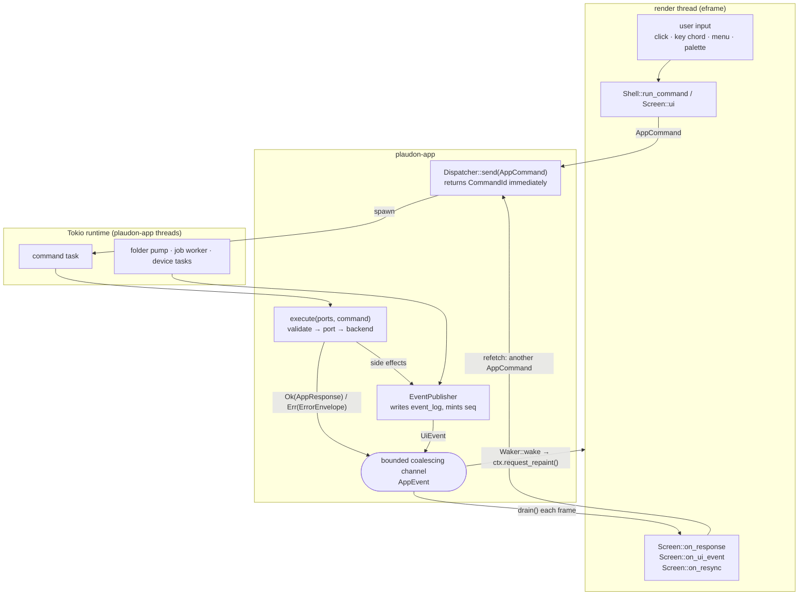

# The egui desktop architecture

How the Rust-only Plaudon desktop application is put together: the layers, the one path from a
click to the library and back, the crate map, the threading and repaint model, and what it takes to
add a screen.

This describes the code as it stands. `docs/EGUI_MIGRATION_PLAN.md` says what is still missing and
why (its `Status` column is the honest gap list); `docs/EGUI_TESTING.md` says how it is tested;
`docs/EGUI_BUILD.md` says how it is built and packaged; `docs/EGUI_DESIGN_SYSTEM.md` says what it
looks like.

---

## 1. Four layers, one direction

```
apps/plaudon-egui          the binary: eframe, the window, the OS
        │  owns Desktop adapters, HostHooks, the screen registration
        ▼
crates/ui (plaudon-ui)     the shell and the screens: egui only, no OS, no I/O
        │  sends AppCommand, reads AppEvent
        ▼
crates/app (plaudon-app)   the application: dispatcher, ports, backends, events
        │
        ▼
crates/* (domain, app-core, persistence, audio, export, …)   the rules
```

Each arrow points one way and no arrow points back up.

* **`plaudon-app` has no user-interface dependency of any kind** — no `tauri`, no `egui`, no
  `eframe` (`crates/app/src/lib.rs:1-26`). A user interface is a caller of
  `command::Dispatcher` and a reader of `event::EventReceiver`, and nothing else. That is what
  made replacing the Tauri shell a UI change rather than a rewrite, and it is what keeps the
  headless automation CLI (`crates/automation`) and the egui app the same application.
* **`plaudon-ui` has no operating system dependency.** It opens no file, spawns no thread, reads no
  environment variable and calls no dialog. Everything it cannot do itself it asks for through
  `shell::HostHooks`, a struct of five closures the binary fills in
  (`crates/ui/src/shell/host.rs`). A test fills them in with fakes; that is the whole mocking
  story.
* **`plaudon-platform` has no egui dependency.** File dialogs, the clipboard, "reveal in Finder",
  the OS colour scheme, file associations, activation URLs, drag-and-drop classification and the
  tray live there as traits with a native and a fake implementation each, so they are testable
  without a window.
* **The binary is the only place where the three meet.** It owns the eframe `App`, constructs the
  engine, builds the real `HostHooks`, registers the screens and drains the OS adapters.

Three rules hold throughout the shell (`crates/ui/src/shell/mod.rs:9-20`):

1. **One command map.** The menu, the toolbar, the palette, the keyboard map and a screen's own
   entries all run `CommandSpec`s from one `CommandRegistry`, so the keyboard reference cannot
   drift from what the keyboard does.
2. **Nothing reaches the application except through the dispatcher.** The shell never calls a
   backend, never blocks and never awaits.
3. **No polling.** The shell repaints when there is an event, an input or a running animation.

---

## 2. Command and event flow

A view never calls a backend. It mints an `AppCommand`, the dispatcher runs it on the Tokio
runtime, and the answer comes back as an `AppEvent` on a bounded channel that the render loop
drains at the top of the next frame.



### What travels on each edge

| Edge | Type | Where |
| --- | --- | --- |
| view → application | `AppCommand` (one variant per published command) | `crates/app/src/command.rs:105` |
| dispatcher → caller | `CommandId`, synchronously, never a result | `command.rs:351` |
| application → view (answer) | `AppEvent::Response { id, command, result }`, the result boxed so the common `Ui` event does not pay for the widest response DTO | `crates/app/src/event.rs:98` |
| application → view (change) | `AppEvent::Ui(UiEvent { seq, kind, recording_id, job_id, hints })` | `crates/app/src/dto.rs:2949` |
| channel overflow or a gap in `seq` | `AppEvent::Resync { reason, dropped }` | `event.rs` |

**Events never carry state.** A `UiEvent` says *something changed*; it is a cue to refetch, not a
patch to apply. That contract came from the React `EventBus` and is kept verbatim: a screen's
`on_ui_event` issues another command rather than mutating what it holds. When the channel coalesces
or overflows, `AppEvent::Resync` tells every screen that everything it holds may be stale, and the
screens refetch. There is therefore no state-reconciliation code anywhere in the UI, and no way for
the UI to invent a value the application never produced.

**Nothing blocks the render thread.** `Dispatcher::send` returns a `CommandId` and spawns;
`Dispatcher::call_blocking` exists for tests, the headless harness and startup paths and asserts it
is not called from inside the runtime (`command.rs:383-392`).

**Errors are values.** A failed command answers `Err(ErrorEnvelope { code, message, retryable,
action, diagnostic_id })` — the same closed `AppErrorCode` set the Tauri shell used. The UI renders
the envelope; it does not classify failures itself.

---

## 3. Crate map

### The UI-facing crates

| Crate | Path | What it owns | Depends on |
| --- | --- | --- | --- |
| `plaudon-app` | `crates/app` | ports, backends, DTOs, validation, the error envelope, `Dispatcher`, the `AppEvent` channel, the Tokio runtime, shell state, the keychain, notifications, media resolution, the update root | the core crates; **no UI** |
| `plaudon-ui` | `crates/ui` | the shell (nav, menu, toolbar, panes, status bar, toasts, palette, keymap, themes) and every screen | `egui`, `plaudon-app`, `plaudon-craft-ui`, `plaudon-transcript-doc`, `plaudon-audio-playback`; **no OS** |
| `plaudon-platform` | `crates/platform` | dialogs, clipboard, opener, OS theme, tray, drag-drop classification, activation parsing, file associations | `rfd`, `arboard`, `tray-icon`; **no egui** |
| `plaudon-audio-playback` | `crates/audio-playback` | integer playback time, the `PcmSource` cursor, the mixer and `cpal` output, the multiresolution peak pyramid and its worker pool | `plaudon-audio`, `symphonia`, `cpal`; **no UI** |
| `plaudon-transcript-doc` | `crates/transcript-doc` | the transcript document model: stable identities, the invertible operation log, citation survival, the save path | `plaudon-domain`; **no UI** |
| `plaudon-craft-ui` | `third_party/craft-ui` | vendored egui primitives (split layout, divider, …) | `egui` |
| `plaudon-ui-testkit` | `crates/ui-testkit` | the one kittest harness: fixed size, scale, theme and OS, the `a11y` assertions, the `visual` snapshot gate | `egui_kittest` |
| `plaudon-egui` | `apps/plaudon-egui` | the binary: eframe setup, `PlaudonShell`, the `Desktop` adapters, screen registration, packaging inputs | all of the above |

### The core crates underneath

`domain` (identities, `Timestamp`, `Money`, `AlignmentOrigin`, the 55 `AppErrorCode`s),
`app-core` (deletion disclosure, speakers, the rules the backends enforce), `persistence`,
`jobs`, `security`, `diagnostics`, `audio`, the `ai-*` family, the `source-*` and `plaud-*`
families, `export`, `notifications`, `automation`, `eval`, `updater`, `release-tools`. None of them
knows the UI exists.

---

## 4. Threading and repaint

### The threads

| Thread | Created by | Does |
| --- | --- | --- |
| render / main | `eframe::run_native` | input, layout, painting, draining `AppEvent`s, draining `DesktopEvent`s |
| Tokio worker pool (`plaudon-app`) | `AppEngine::start` (`crates/app/src/runtime.rs:206`), multi-threaded, `enable_all`, thread name `plaudon-app` | every command, the job worker, device tasks, the watched-folder pump |
| audio mixer | `plaudon-audio-playback` (`engine.rs:593`) | fills the lead buffer ahead of the device callback |
| audio device callback | `cpal` | copies from the lead buffer; never decodes, never locks for long |
| peak workers | `PeakWorkerPool` (`crates/audio-playback/src/worker.rs:217`) | decode a recording into a peak pyramid, cancellable, progress-reporting |

The render thread owns no `Arc<Mutex<…>>` of application state, because it holds no application
state that the application also holds: it holds what the last response gave it.

### The repaint model

egui is immediate-mode, so "update the UI" means "ask for a frame". Plaudon never spins:

* `AppEngine` takes an injectable `Waker` (`event::Waker`). The binary installs one whose `wake()`
  calls `egui::Context::request_repaint` (`apps/plaudon-egui/src/shell_app.rs`). A command that
  finishes, a job that progresses, a device that appears — all of them wake the window from the
  Tokio side, through the channel, with no timer.
* `PlaudonShell::view` drains the channel first, dispatches each `AppEvent` into the shell, then
  paints. One frame therefore sees one consistent batch of changes.
* The channel is **bounded and coalescing**: events with the same `(kind, recording_id, job_id)`
  collapse, so a job emitting progress at device rate cannot force a frame per event. Overflow is
  reported as `Resync`, never silently dropped.
* Shell state (window geometry, panel sizes, appearance, contrast) is saved through a debounced
  hook — the shell asks for a delayed repaint rather than writing on every drag frame — and flushed
  on exit.
* Long work never runs on the render thread. Waveform building is a `PeakWorkerPool` request whose
  completions are polled each frame; audio decoding happens on the mixer thread; everything else is
  a command.

### Shutdown

`eframe::App::on_exit` → `PlaudonShell::shutdown` → every screen's `Screen::on_shutdown` (the last
chance to dispatch a pending autosave) → `AppEngine::shutdown(grace)`, which gives the runtime a
bounded grace period to finish those commands before the process exits. Nothing is painted after
that, so a screen must not expect a response to a command it sends there.

---

## 5. The shell's own moving parts

| Piece | File | Note |
| --- | --- | --- |
| `Route` / `Destination` | `shell/route.rs` | six destinations, twelve route variants, `path()` and `parse()` — the hash routes the React app used, kept so a deep link means the same thing |
| `CommandRegistry` / `CommandSpec` / `ShellAction` | `shell/commands.rs` | one id per action, an optional default chord, `rebindable` or `fixed` |
| keyboard map | `shell/shortcuts.rs` | chords resolved against the registry; `display(chord, os)` renders Cmd on macOS and Ctrl elsewhere |
| menu bar | `shell/menu.rs` | in-window, in the AccessKit tree, driven by the registry; two drift tests fail if a command is unreachable |
| command palette | `shell/palette.rs` | the same registry, filtered |
| layout | `shell/layout.rs`, `third_party/craft-ui` | resizable sidebar and aside, compact breakpoint |
| screens | `shell/screen.rs` | the `Screen` trait and `ScreenRegistry` |
| window state | `shell/window_state.rs` | geometry sanitised against the reported scale, restored through `ViewportBuilder` |
| host escape hatch | `shell/host.rs` | `pick_audio_files`, `pick_folder`, `pick_save_path`, `save_shell_state`, `reveal_in_folder` |

`ScreenCtx` is what a screen is handed for one frame: `send(AppCommand) -> CommandId`, `navigate`,
`toast`, `set_status`, `tokens()`, `hooks()`, `request_repaint()`. It is the entire surface between
a screen and everything else.

---

## 6. Adding a screen

A worked order of operations. Nothing here is optional; the registration test and the menu drift
tests fail otherwise.

1. **Decide the destination.** If it is one of the six existing `Destination`s, you are adding a
   screen for a destination that has none or replacing one. A genuinely new destination means a new
   `Destination` variant, a new `Route` variant with `path()`/`parse()` round-tripping, a nav-rail
   entry and a `nav_*` command with a `Mod+N` chord — do that only if the information really is a
   peer of Library and Jobs.

2. **Write the screen in `crates/ui/src/screens/<name>/mod.rs`.** Implement `Screen`:

   ```rust
   impl Screen for ThingScreen {
       fn destination(&self) -> Destination { Destination::Thing }

       fn ui(&mut self, ui: &mut egui::Ui, cx: &mut ScreenCtx<'_>) {
           if self.need_fetch {
               self.pending = Some(cx.send(AppCommand::ListThings(ListThingsRequest { .. })));
               self.need_fetch = false;
           }
           // paint from self.state only
       }

       fn on_response(&mut self, id: CommandId, command: &'static str,
                      result: &Result<AppResponse, ErrorEnvelope>, cx: &mut ScreenCtx<'_>) {
           if Some(id) != self.pending { return; }   // match the id you kept
           // store the response, or store the envelope and render it
       }

       fn on_ui_event(&mut self, event: &UiEvent, cx: &mut ScreenCtx<'_>) {
           if matches!(event.kind, EventKind::LibraryChanged) { self.need_fetch = true; }
       }

       fn on_resync(&mut self, _reason: ResyncReason, _cx: &mut ScreenCtx<'_>) {
           self.need_fetch = true;   // everything held may be stale
       }
   }
   ```

   Rules the review will hold you to: paint from your own state and nothing else; never block;
   never read the clock for anything you will assert on; keep the `CommandId` you were given and
   ignore answers to commands you did not send; refetch on an event instead of patching; render an
   `ErrorEnvelope` rather than inventing a message; and virtualize anything that can be long
   (`TableBuilder::body.rows`, `ScrollArea::show_rows`) from the first commit, not after.

3. **Give it commands, if it has any.** Return `&[CommandSpec]` from `Screen::commands()` and
   handle them in `Screen::handle_command`. They appear in the palette and the keyboard reference
   automatically. A command that should also be in the menu is added to the shared description,
   `shell::menu::menu_model()`, which the in-window menu bar and the macOS application menu both
   render; the drift test `every_shell_command_is_reachable_from_the_menu_or_is_a_key_only_action`
   is what reminds you.

4. **Ask the host, do not reach for the OS.** Need a file? `cx.hooks().pick_audio_files`. Need to
   reveal something in Finder? `cx.hooks().reveal_in_folder`. If no hook fits, add a field to
   `HostHooks` with a `none()` default so every existing test still compiles, implement it in
   `apps/plaudon-egui/src/main.rs::native_hooks`, and give `plaudon-platform` the real adapter plus
   its fake.

5. **Register it.** Add it to `apps/plaudon-egui/src/screens::register_all`, which the binary *and*
   every integration test call, so the application a test drives is the application that ships.
   `tests/registration.rs::every_destination_has_a_screen` fails if a destination has none.

6. **Test it with kittest only.** `plaudon_ui_testkit::builder()` for the harness, `a11y::nodes`
   for roles and labels, `a11y::focus_order` for keyboard reachability, the output-collector
   pattern in `crates/ui/tests/` for asserting which commands were dispatched with which payload.
   Pixel snapshots are opt-in through `PLAUDON_VISUAL=1` and valid only from the MARS renderer
   (`docs/EGUI_TESTING.md` §4). A test crate that drives the pointer must enable egui's
   `default_fonts`.

7. **Update the parity matrix.** `docs/EGUI_MIGRATION_PLAN.md` §4 has a row for everything; the
   `Status` column is the contract. Say what is true, including what is still missing.
