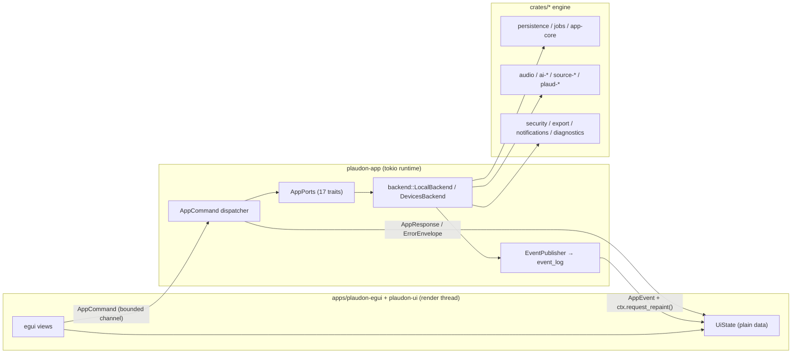

# egui migration plan

How Plaudon's desktop UI moves from Tauri 2 + React/TypeScript to egui 0.36 + eframe, Rust only.
EPIC O (#197), task O1.1 (#199). Docs only — this file describes what exists and what will be built;
it invents nothing.

**Audited tree:** the integration worktree carrying every merged EPIC branch (`4230963`, "Merge
epic-j-export-archive"), which is ahead of `origin/main`. Every statement below was read out of that
tree; file and line references are relative to the repository root. Where a fact could not be
verified by reading, it is marked `[INFERENCE]`.

Companion documents: `docs/EGUI_BASELINE.md` (measured baseline of the app being replaced),
`docs/EGUI_REFERENCE_COMPONENTS.md` (what can be reused from photocraft, filmcraft, wordcraft and
craft-libs) and `docs/EGUI_ARCHITECTURE.md` (the layers, the command/event flow, the threading and
repaint model, and how to add a screen to what was built).

---

## 1. The shape of the problem

Plaudon is already a Rust application with a thin web skin. The 26 crates under `crates/` contain no
Tauri dependency at all, and the shell crate `apps/desktop/src-tauri` is itself mostly Tauri-free:
of its 26,366 Rust lines, only `lib.rs`, `main.rs`, `events.rs::TauriEventSink`, `media.rs`,
`commands/mod.rs` (the `#[tauri::command]` wrappers), `build.rs`, `tauri.conf.json` and
`capabilities/default.json` touch Tauri. The ports layer (`ports.rs`, 17 async traits), the backend
implementations (`backend/*.rs`), the DTOs (`dto.rs`, 3,277 lines), the validators (`validate.rs`,
1,525 lines), the error envelope (`error.rs`), the keychain store (`secrets.rs`) and the notification
service (`notify.rs`) have no `tauri::` usage.

That makes this a UI replacement, not an application rewrite. The work splits cleanly:

1. **Extract** the Tauri-free application layer into a `plaudon-app` crate (O1.2, #200).
2. **Replace** five Tauri facilities: the IPC command layer, the event emit, the file dialog plugin,
   the `plaudon-media://` audio URI scheme, and the bundler.
3. **Rebuild** 64 React components and 11 screens as egui widgets, in a new `plaudon-ui` crate and
   `apps/plaudon-egui` binary.
4. **Build what never existed in Rust**: waveform peak generation, audio playback, granular job
   progress, a command palette, and layout/window-state persistence.

The last item is the real cost. Three capabilities the React app gets from the browser have no Rust
counterpart in this repository today:

| Capability | Today | After |
| --- | --- | --- |
| Audio playback | `<audio src="plaudon-media://localhost/<uuid>">` fed by `media.rs` | a Rust audio output device (`cpal`-class dependency, new) |
| Waveform peaks | `AudioContext.decodeAudioData` in the webview, ≤2,000 absolute-peak buckets (`playerState.ts:118-128`) | a Rust multiresolution peak builder over `plaudon-audio` (new, O1.5 #203) |
| File pickers | `@tauri-apps/plugin-dialog` `open()`/`save()` | `rfd`-class dependency (new) |

None of `rodio`, `cpal`, `kira`, `rfd`, `egui` or `eframe` appears in `Cargo.lock` or any manifest
today (verified by grep); all are new dependencies requiring licence-register entries (§11).

---

## 2. Verified inventory

### 2.1 Workspace members and entry points

Root `Cargo.toml`: `resolver = "2"`, members `crates/*`, `apps/desktop/src-tauri`,
`tests/integration`, `tests/chaos`, `tests/hardware`, `tests/egress/{monitor,scenario,harness}`;
`exclude = ["fuzz"]`. Workspace package: version 0.1.0, edition 2021, `rust-version = "1.90"`,
licence MIT. `rust-toolchain.toml` pins channel `stable` with rustfmt + clippy.
`rustfmt.toml`: max_width 100, Unix newlines. Workspace lints: `unsafe_code = "warn"`,
`missing_debug_implementations = "warn"`, `clippy::all = deny`, `clippy::pedantic = warn` with 14
named allows. Every crate must carry `[lints] workspace = true`
(enforced by `tests/integration/tests/workspace_layout.rs:282`). There are no `[profile.*]` sections.

| Area | Crates |
| --- | --- |
| Core | `domain`, `app-core`, `persistence`, `jobs`, `security`, `diagnostics` |
| Media & AI | `audio`, `ai-contracts`, `ai-whisper`, `ai-apple`, `ai-openrouter`, `ai-diarization`, `ai-tools`, `ai-local-llm` |
| Sources & devices | `recording-sources`, `source-plaud-device`, `source-plaud-cli`, `source-folder`, `plaud-ble`, `plaud-usb`, `plaud-wifi`, `plaud-protocol` |
| Output & integration | `export`, `notifications`, `automation`, `eval` |

26 crates. `plaudon-eval` is a `crates/*` member but is **not** listed in `[workspace.dependencies]`.

Binary entry points today:

| Binary | Path | Purpose |
| --- | --- | --- |
| `plaudon-desktop` | `apps/desktop/src-tauri/src/main.rs` | the Tauri shell; calls `plaudon_desktop::run()` |
| `plaudon` | `crates/automation/src/bin/plaudon.rs` | user-local scripting CLI, `#[tokio::main(flavor = "current_thread")]` |
| `mock_plaud` | `apps/desktop/src-tauri/src/bin/mock_plaud.rs` | test-only stand-in for the vendor CLI (`test-harness`) |
| `plaudon-tauri-audit` | `crates/security/src/bin/tauri_audit.rs` | CI least-privilege auditor for the Tauri surface |
| `plaudon-sandbox-probe` | `crates/security/src/bin/…` | sandbox probe |
| `plaudon-secret-scan` | `crates/diagnostics` (feature `scanner`) | secret scanner |
| `extraction-eval` | `crates/eval/src/bin/extraction-eval.rs` | hermetic extraction evaluation |
| `plaud-cli-probe`, `plaud-apple-probe`, `plaudon-chaos-worker` | feature-gated probes | opt-in diagnostics |

`crates/automation` is the existing proof that `app-core` + `persistence` + `jobs` run headless with
no GUI: `commands::run(&Command, &Path, now_ms) -> Envelope`.

### 2.2 The Tauri shell

**54 `#[tauri::command]` functions**, all in `apps/desktop/src-tauri/src/commands/mod.rs:188-618`.
Every one has the shape
`pub async fn NAME(state: State<'_, AppState>, request: REQ) -> CommandResult<RESP>` whose body is
`to_command_result(<module>::<fn>(&state.ports, request).await)`. Four take
`Option<EmptyRequest>` and ignore it. The per-module functions in `commands/<module>.rs` are already
Tauri-free and take `&AppPorts`.

| Module | Commands |
| --- | --- |
| `library` (2) | `list_recordings`, `get_recording` |
| `import` (1) | `import_files` |
| `transcript` (2) | `get_transcript`, `save_transcript_revision` |
| `jobs` (4) | `list_jobs`, `cancel_job`, `retry_job`, `export_recording` |
| `settings` (7) | `get_capabilities`, `set_notification_settings`, `set_local_only_mode`, `set_openrouter_key`, `remove_openrouter_key`, `list_activity`, `complete_onboarding` |
| `sources` (9) | `plaud_probe`, `plaud_connect`, `plaud_disconnect`, `plaud_list`, `plaud_import`, `source_add_folder`, `source_sync`, `source_reconcile`, `list_source_artifacts` |
| `search` (1) | `search_library` |
| `speakers` (4) | `list_speakers`, `rename_speaker`, `confirm_speaker`, `reset_speaker` |
| `cloud` (8) | `list_models`, `start_processing`, `grant_cloud_consent`, `revoke_cloud_consent`, `get_usage`, `set_cloud_budget`, `set_model_preference`, `verify_model` |
| `devices` (7) | `list_nearby_devices`, `device_probe`, `device_authorize`, `device_list_recordings`, `device_import`, `device_disconnect`, `device_sync_policy` |
| `outputs` (3) | `list_outputs`, `review_claim`, `regenerate_output` |
| `archive` (6) | `export_media`, `get_deletion_disclosure`, `delete_recording`, `create_portable_backup`, `inspect_restore_archive`, `restore_portable_archive` |

`tauri::generate_handler!` at `commands/mod.rs:124-186` lists **60** entries because the six
`archive` commands appear twice; `COMMAND_ALLOWLIST` repeats the same duplication, so the test
`every_registered_handler_is_on_the_allowlist` compares 60 against 60 and passes. **The rewrite must
use the 54 unique names and the duplication must not be carried forward.** The TypeScript
`CommandMap` has 51 keys — it omits `list_outputs`, `review_claim` and `regenerate_output`, which
exist in Rust and in the JSON schemas but have no caller in the React app.

**19 UI event kinds**, one emit site. `events.rs:222-229`:
`impl EventSink for TauriEventSink<R> { … self.app.emit(event.kind.as_str(), &event) }`. No
`emit_to`, no `emit_all`, no `tauri::ipc::Channel` anywhere. Payload is always
`dto::UiEvent { seq: u64, kind: EventKind, occurred_at: String, job_id, recording_id, payload: Map }`
(`dto.rs:2885`). `EventPublisher::publish` inserts into the SQLite `event_log` table **after** the DB
commit to obtain a monotonic `seq`, then calls `EventSink::emit`.

| Event | Emitted from |
| --- | --- |
| `job.updated` | `backend/jobs.rs:372-380`, `backend/export.rs:152-157` |
| `job.failed` | `backend/jobs.rs:373` |
| `recording.imported` | `backend/import.rs:394-398`, `backend/sources.rs:1288,1396` |
| `recording.source_updated` | `backend/sources.rs:1045,1447` |
| `transcript.completed` | `backend/mod.rs:963-967` |
| `tool.completed` | *no emit site* |
| `model.availability_changed` | `backend/cloud.rs:1539-1544` |
| `consent.required` | *no emit site* |
| `source.auth_required` | `backend/sources.rs:328-332` |
| `source.sync_finished` | `backend/sources.rs:345-348` |
| `library.changed` | `backend/import.rs:407`, `backend/mod.rs:1070`, `backend/sources.rs:1299,1404` |
| `activity.added` | `backend/import.rs:403`, `backend/sources.rs:1296` |
| `ui.activation_requested` | `notify.rs:263-275` (notification click) |
| `device.discovered` | `backend/devices.rs:1292-1296` |
| `device.connected` | `backend/devices.rs:1699-1702` |
| `device.compatibility_changed` | `backend/devices.rs:1423-1427` |
| `device.transfer_progress` | `backend/devices.rs:1829,1892` |
| `device.transfer_verified` | `backend/devices.rs:1111-1113` |
| `device.disconnected` | `backend/devices.rs:1301,1597,1908` |

17 of 19 have emit sites. The frontend `EventBus` (`src/ipc/eventBus.ts`) detects `seq` gaps and asks
for a full refetch rather than patching state — **events never carry state, they trigger reloads**.
That contract is worth keeping verbatim in egui.

**One managed state**: `AppState { pub ports: AppPorts }` (`lib.rs:83-88`), managed at `lib.rs:256`.
`AppPorts` holds 18 `Arc<dyn …>` port objects plus an `EventPublisher`. Construction
(`lib.rs:224-258`): clone the app handle → `app_data_dir()` → `TauriEventSink` → `KeyringSecretStore`
→ notification `Dispatcher` (starting disabled) → `block_on(build_ports(…))` → `manage`.
`build_ports_with_radio` (`lib.rs:126-198`) does: `LocalBackend::open(data_dir, sink, notifications,
secrets, approved_roots)`, `backend.reconcile_startup()`, `DevicesBackend::new(DevicesDeps::production(…))`,
`devices.recover_interrupted()`. This single function is the composition root the egui app must
reproduce, minus the `AppHandle`.

**One plugin**: `tauri_plugin_dialog::init()` (`lib.rs:220`). No Rust code calls it; it is used only
from JavaScript (`useImport.ts:169`, `RecordingDetailScreen.tsx:464`, `ExportMenu.tsx:6`,
`BackupRestoreSection.tsx:6`). **Not present anywhere**: tray, menu, single-instance, deep link,
autostart, window-state, updater, shell/opener, fs scope, http, global-shortcut, clipboard,
notification plugin.

**One custom URI scheme**: `media.rs:244-278` registers `plaudon-media` asynchronously. It resolves a
bare UUID path through `LibraryPort::resolve_media`, honours a single `Range` header, serves at most
`MAX_CHUNK_BYTES` (4 MiB) per response, and returns 200/206/400/404/416/503 with
`Content-Type`, `Accept-Ranges`, `Cache-Control: no-store`, `Content-Length`, `Content-Range`.
MIME map covers wav, mp3, m4a, flac, ogg, opus.

**`tauri.conf.json`**: product `Plaudon`, identifier `app.plaudon.desktop`, one window `main`
(1280×820, min 880×560, resizable, `dragDropEnabled: true`), strict CSP, `assetProtocol` disabled,
`freezePrototype: true`, bundle targets `["app", "dmg", "msi"]`, category Productivity, four PNG
icons. **No signing block, no entitlements, no `Info.plist`, no updater, no WiX/NSIS config, no
`.icns`/`.ico`.** `capabilities/default.json` grants 12 permissions: `core:event:default`,
`core:app:default`, six `core:window:*`, `core:webview:allow-webview-close`, `dialog:allow-open`,
`dialog:allow-save`.

**`src-tauri/tests/`**: 6 files, 38 test functions. `end_to_end.rs` (13) drives `AppPorts` directly
with no Tauri runtime; `plaud_commands.rs` (17) uses the `mock_plaud` binary; `device_import_e2e.rs`
(5) exercises fake device transfers; `schema_conformance.rs` (5) and `source_schema_conformance.rs`
(4) validate DTOs against `schemas/commands/v1/*.schema.json` and `schemas/events/ui-event.v1.schema.json`;
`logging_policy.rs` (2) forbids a non-redacting tracing subscriber.

**Dependencies**: 31 + 1 build + 8 dev. Tauri-only: `tauri = "2"`, `tauri-plugin-dialog = "2"`,
build-dep `tauri-build = "2"`, plus `crate-type = ["lib", "cdylib", "staticlib"]` and
`tauri::generate_context!()`. Everything else is reusable: 17 `plaudon-*` path deps, `tokio`,
`sqlx`, `serde`, `serde_json`, `sha2`, `hex`, `thiserror`, `time`, `tokio-util`, `tracing`, `uuid`,
`async-trait`, `keyring 3` (apple-native, windows-native, sync-secret-service), `dirs 6`,
`sysinfo 0.37`, optional `btleplug 0.11` (feature `hardware-scan`).

`build.rs` forwards `DEP_*_LINK_ARGS` from `plaudon-ai-apple` as `cargo:rustc-link-arg` (Swift
runtime rpath and weak-linked `Speech`/`FoundationModels` frameworks) before calling
`tauri_build::build()`. **The link-arg forwarding must survive**: Cargo does not propagate a
`links` dependency's link args to the final binary automatically.

### 2.3 The React frontend

React 19 + Vite 7 + TypeScript 5.9, hash routing, no router library, no state library
(React Context + `useReducer` only). Six destinations (`Mod+1`…`Mod+6`): Library, Inbox, Jobs,
Templates, Settings, Devices. 12 route variants.

**11 screen-level views**

| # | Screen | File | Commands it calls |
| --- | --- | --- | --- |
| 1 | `OnboardingFlow` | `features/onboarding/OnboardingFlow.tsx` | `set_local_only_mode`, `set_openrouter_key`, `complete_onboarding` |
| 2 | `LibraryScreen` | `features/library/LibraryScreen.tsx` | `list_recordings` (+`import_files`) |
| 3 | `SearchScreen` | `features/search/SearchScreen.tsx` | `search_library` |
| 4 | `RecordingDetailScreen` | `features/recording/RecordingDetailScreen.tsx` | `get_recording`, `export_recording`; children call `get_transcript`, `save_transcript_revision`, `set_model_preference`, `start_processing`, `list_models`, `verify_model`, `grant_cloud_consent`, `set_cloud_budget` |
| 5 | `InboxScreen` | `features/library/InboxScreen.tsx` | two `list_recordings` queries unioned |
| 6 | `JobsScreen` | `features/jobs/JobsScreen.tsx` | `list_jobs`, `cancel_job`, `retry_job` |
| 7 | `TemplatesScreen` | `features/templates/TemplatesScreen.tsx` | none — static "Templates are not part of this build" |
| 8 | `SettingsScreen` | `features/settings/SettingsScreen.tsx` | `set_local_only_mode`, `set_openrouter_key`, `remove_openrouter_key`, `get_usage`, `set_cloud_budget`, `revoke_cloud_consent`, `set_notification_settings` |
| 9 | `ActivityScreen` | `features/activity/ActivityScreen.tsx` | `list_activity` |
| 10 | `SourcesScreen` | `features/sources/SourcesScreen.tsx` | `plaud_probe`, `plaud_connect`, `plaud_disconnect`, `plaud_list`, `plaud_import` |
| 11 | `DevicesScreen` | `features/devices/DevicesScreen.tsx` | `list_nearby_devices`; `DeviceDetail` adds `device_probe`, `device_authorize`, `device_list_recordings`, `device_import`, `device_disconnect`, `device_sync_policy` |

**Shared primitives** (`src/components`, 7 exports): `Button` (variants default/primary/danger/quiet
plus a text `glyph`), `Dialog` (role `dialog`/`alertdialog`, focus trap, Escape, focus restore),
`EmptyState`, `TextField`, `SelectField`, `Progress` (indeterminate when value is null),
`StatusBadge` (tone + glyph + label — never colour alone).

**State**: one context store (`AppState.tsx`: capabilities, route, event bus, toasts, appearance,
contrast) plus five reducers — `themeReducer` (`design/theme.ts`), `playerReducer`
(`recording/playerState.ts`), `libraryQueryReducer` (`library/libraryQuery.ts:148`),
`onboardingReducer` (`onboarding/onboardingMachine.ts:69`), `EditState`
(`recording/transcriptEditing.ts`) — plus `ImportContext`. Seven state containers total.

**IPC**: `Transport { invoke(command, args); listen(kind, handler) }`; `invokeCommand<K>` is typed by
`CommandMap`; errors become `CommandError` carrying an `ErrorEnvelope { code, message, retryable,
action?, diagnostic_id }`. `contract.ts` is hand-written (1,742 lines) and guarded against drift by
`contract.schema.test.ts` against `schemas/commands/**`. `src/generated/jobEvents.ts` is generated
from `schemas/events/job-events.v1.schema.json` and is imported by nothing.

**Audio player** (`AudioPlayer.tsx`, 453 LOC): a native `<audio preload="metadata">` element pointed
at `mediaUrl(recordingId)`. Controls: play/pause; Back 10 s / Forward 10 s (`SKIP_MS = 10000`);
speed select `[0.5, 0.75, 1, 1.25, 1.5, 2]`; a `role="slider"` scrubber with `aria-valuetext`
(ArrowLeft/Down −5 s, ArrowRight/Up +5 s, PageUp/Down ∓30 s, Home, End) and pointer-ratio seek.
Window shortcuts (`usePlayerShortcuts`): Space toggle, J −10 s, L +10 s, K pause, `,` slower,
`.` faster — suppressed in text entry and inside dialogs. When the duration is unknown the slider is
not rendered at all and the text reads "Duration unknown"; the skip buttons are disabled.

**Waveform** (`AudioPlayer.tsx:312, 364-450`): a hand-written `<canvas aria-hidden>`. `usePeaks`
fetches the media URL, calls `AudioContext.decodeAudioData`, takes channel 0, and reduces it to at
most `MAX_PEAK_BUCKETS = 2000` absolute-peak buckets, 200 buckets per `requestIdleCallback` slice,
repainting progressively. The canvas draws `min(peaks.length, pixelWidth)` bars, played portion in
`--color-accent`. **One resolution, no zoom, no drag, no regions, no selection**; if decoding is
unavailable it falls back to a plain progress track. The whole file is decoded in JS.

**Transcript editor** (`TranscriptPane.tsx` 576 LOC + `transcriptEditing.ts`): not contenteditable.
Each segment is a `role="button"` row; Enter or double-click swaps in a `<textarea>`; Escape cancels
the session. Draft overlay `EditState { drafts: Map<index, text>, past[], future[] }`; one editing
session coalesces to one undo step; `Cmd/Ctrl+Z` and shifted redo. `toEdits` sends only changed
segments to `save_transcript_revision` with a `base_revision_id`; a `CONFLICT` envelope offers
"Reload newest revision" or "Copy my changes" and never discards the user's text. Speaker labels are
read-only spans. Timestamp chips appear only when `alignment_origin != 'none'` and `start_ms` is
present, labelled "approximate (derived)" for derived alignment. Search is incremental, literal,
case-insensitive, with `<mark>` runs and prev/next navigation. **Find-and-replace does not exist**;
`Mod+F` is documented in `shortcuts.ts` but no handler binds it. Virtualization is
`@tanstack/react-virtual` (overscan 6, 96 px estimate, measured rows) over cursor pages of 200
segments. Annotations render as `StatusBadge` (low confidence, possible hallucination, inaudible,
edited). **There is no auto-follow of the playing segment.**

**Design system** (`src/design`): plain CSS consuming custom properties written by `applyTokens()`.
Spacing scale 0/2/4/8/12/16/24/32/48 px; radii 3/6/10; type scale 11/12/13/15/19/24 with weights
400/550/650; motion 90 ms / 160 ms; **20 semantic colour roles** across four themes (light, dark,
hc-light, hc-dark). Focus ring 2 px (3 px in high contrast), offset 2. System fonts only. No icon
library — text glyphs and single letters. `tokens-only.test.ts` fails the build if any CSS file
contains a literal colour or a non-token spacing value.

**Dialogs and notifications**: all modals are in-DOM (`components/Dialog.tsx`); toasts are an
`aria-live="polite"` region with manual dismissal and no auto-timeout. Native OS dialogs come only
from the Tauri dialog plugin. OS notifications are emitted by Rust (`plaudon-notifications`), and the
UI only renders the permission state and handles `ui.activation_requested`.

**Not present**: command palette, i18n, any persisted UI state (no `localStorage`/`sessionStorage`/
`indexedDB` anywhere), charting, icon set, snapshot tests.

**Orphans** — exported, unit-tested, mounted nowhere: `ExportMenu`, `DeleteRecordingDialog`,
`BackupRestoreSection`, `SpeakerManagementPanel`, `SpeakerControls`, `useSpeakerCommands`. Four
commands have no caller at all: `source_add_folder`, `source_sync`, `source_reconcile`,
`list_source_artifacts`. The egui UI is expected to mount these flows, not reproduce the gap.

### 2.4 Core crates (reusable as they stand)

`domain` — identities (16 typed UUID newtypes), `Timestamp`, `TimeRangeMs`, `Money`/`MoneyEstimate`
(`Unknown` / `Estimated` / `Finalized`), `MediaIdentity`, `QualityClass`, `Recording`,
`TranscriptRevision` + `TranscriptSegment { seq_index, start, end, text, confidence, speaker_id, words }`,
`AlignmentOrigin { Native, Derived, None }` with `permits_seek()`, `SourceAnchor`/`VerifiedAnchor`,
`Claim`/`ClaimState`/`ClaimKind`, `StageKind`, `CapabilityStatus`, and the closed `AppErrorCode` set
(55 codes) with `ErrorAction` (14 UI affordances). 96 tests. **This is the vocabulary the egui UI
renders.** One rule carries over verbatim: never read `segment.start` for seeking — use
`TranscriptRevision::seek_offsets()` / `permits_seek()` (`transcript.rs:343`).

`app-core` — use-case services over `persistence::Database`, all `Clone`, all `async`:
`LibraryService`, `ImportService`, `ReconciliationService`, `VendorArtifactImporter`,
`DeletionService`, `LibrarySearch`, `SpeakerRegistry`, `ConversationService`, `SummarizationPipeline`,
`TemplateRegistry`, `ModelRegistry`/`ModelInstaller`, plus pure policies (`plan_chunks`,
`select_engine`, `select_text_model`, diarization reconcile, `DedupPolicy`). **There is no
application facade, no `AppState`, and no config loader** — the de-facto application layer is
`apps/desktop/src-tauri`. `app-core` does not own a tokio runtime; callers must supply one
(`sqlx` is `runtime-tokio`).

`persistence` — `sqlx 0.9` over SQLite: WAL, `foreign_keys = ON`, `synchronous = FULL`,
`busy_timeout` 5 s, pool max 8, `backup_to` via `VACUUM INTO`. **No SQLCipher and no
database-at-rest encryption** (grep for `sqlcipher`/`PRAGMA key` across `crates/`: no matches);
encryption exists only for transcript provenance columns and for portable archives. Eleven
migrations, all `STRICT` tables, each in one transaction, preceded by a verified `VACUUM INTO`
backup at `<db>.pre-migration-<v>.bak`, tracked in `schema_migrations` with SHA-256 checksums:

| Version | File | Adds |
| --- | --- | --- |
| 1 | `0001_core_identity.sql` | `recordings`, `recording_tags`, `media_assets`, `recording_media`, `sources`, `source_items`, `media_revisions`, `tombstones` |
| 2 | `0002_core.sql` | devices, device credentials/transfers, `transcript_revisions`, `transcript_segments`, `speakers`, `ai_outputs`, `jobs`, `job_steps`, `inference_attempts`, `usage_events`, `consent_grants`, `app_preferences`, `export_events`, `import_journal`, `compatibility_evidence` |
| 100 | `0100_job_engine.sql` | `job_engine_state`, `job_outputs`, `job_transitions`, `job_checkpoints`, `event_sequence`, `job_events`, `event_consumer_cursors` |
| 200 | `0200_transcript_provenance.sql` | provenance cipher columns, `transcript_words`, `transcript_annotations` |
| 300 | `0300_desktop_shell.sql` | `activity_events`, `event_log`, `recording_import_metadata` — **owned by the shell** |
| 400 | `0400_transcript_tools.sql` | tools, tool runs, conversations, diarization runs, speaker turns, FTS5 `transcript_search` + triggers, automation bridge |
| 450 | `0450_cloud_ai.sql` | model capability records, task defaults, per-recording overrides, route privacy policies |
| 500 | `0500_device_import.sql` | firmware observations, transfer checkpoints |
| 600 | `0600_meeting_intelligence.sql` | pipeline stage runs, `output_claims`, `output_evidence`, `output_dependencies`, staleness triggers |
| 700 | `0700_export_deletion.sql` | deletion records/suppressions, `archive_backups`, `export_derivatives` |
| 800 | `0800_source_reconciliation.sql` | source export artifacts, `watched_folders`, `watched_folder_items` |
| 900 | `0900_voice_profiles.sql` | `people` (the master speaker list), `person_voice_enrollments`, `voice_exemplars`, `speaker_suggestions`, `voice_profile_events`, `speakers.person_id` |

Migration 300 is the shell's own schema. It stays: `activity_events` backs the Activity screen,
`event_log` provides the UI event sequence, `recording_import_metadata` holds the original file name.
Ownership comment at `migrations.rs:74` must be re-pointed at the new crate.

`jobs` — the durable job engine (18 states, legal-edge table, idempotency keys, checkpoints,
crash recovery, `tokio::Semaphore` scheduler per `ResourceClass { Cpu, Gpu, LocalDisk, Ble,
CloudDispatch }`, `CancellationRegistry` over `tokio_util::CancellationToken`). Its UI contract is
`jobs::ui::EventSink` (sync `emit`) over a durable `job_events` table with consumer cursors —
Tauri-free by construction; its doc even names the old binding
("plaudon-desktop implements this with `app_handle.emit`", `ui.rs:57`).

**The desktop shell does not use `plaudon-jobs`.** It is not in `src-tauri/Cargo.toml`;
`backend/jobs.rs:3-7` reads the `jobs` table directly and says `plaudon_jobs` "can replace this
file", and the shell keeps a *second* event stack (`events.rs` + the `event_log` table). Two event
systems therefore exist. Unifying them is desirable but is **not** in scope for EPIC O: this plan
keeps `backend/jobs.rs` behaviour unchanged and ports it as-is, and records the duplication as a
follow-up (§12, R9).

`security` — OS vault only, no plaintext fallback: `SecretStore` trait with macOS
`security-framework` and Windows Credential Manager backends, `SecretScope { OpenRouterApiKey,
DeviceAuthorization { device_id } }`, `SecretString` that zeroises. The single egress gate
(`outbound.rs`): `EgressRequest` → `OutboundPolicy::authorize` → an unforgeable `EgressTicket` or
`EgressDenied`; `EffectiveNetworkPolicy { mode, disabled_capabilities }` is explicitly designed to be
returned to the UI for "why is this disabled". `consent::preflight::dispatch_preflight` returns a
`ConsentPrompt { purpose, content_type, route, destination_label, resolved_retention,
requires_privacy_restriction, disclosure_version, recording_id, offered_scopes }` — exactly the data
model the egui consent sheet renders. `fsguard` canonicalises and validates paths.

`export` — five transcript formats (`Txt`, `Markdown`, `Json`, `Srt`, `Vtt`; captions refused with
`CaptionsUnavailable` when the transcript has no real timestamps), original and sanitised media
export, and the `.recording-archive` portable backup (magic `PLAUDARC`, Argon2id + XChaCha20-Poly1305
STREAM, dry-run inspection, conflict policy, non-portable-settings exclusion, secret scan before
commit).

`notifications` — `Notifier` port with macOS `UNUserNotificationCenter` (objc2) and Windows WinRT
backends, four categories, a privacy-safe payload builder, and a `Dispatcher` with preference and
permission gates, 5 s timeout and panic isolation. **The macOS backend requires a bundled `.app`**:
without a bundle identifier it reports `Unsupported` (`macos.rs:26-33`), so `cargo run` of the egui
binary will not deliver notifications until packaged. The Windows dependency is
`tauri-winrt-notification 0.8` — a WinRT toast wrapper maintained by the Tauri organisation, **not**
the Tauri runtime; it can stay.

`diagnostics` — `init_logging(LoggingConfig)` installs a `tracing-subscriber` registry whose writer
redacts every record before it reaches the file (JSON, 8 MiB × 5 rotation, filter from `PLAUDON_LOG`),
plus `install_crash_hook`, a local metrics registry, and the redactor. **The Tauri shell never calls
`init_logging`** — `lib.rs:298` only emits a debug line. The egui binary must call `init_logging` and
`install_crash_hook` and choose a log directory. `logging_policy.rs` forbids any other subscriber.

`automation` — the `plaudon` CLI; reads the same `app_preferences['desktop.preferences']` row the GUI
writes, so GUI and CLI must keep agreeing on that key.

### 2.5 Sources, devices and audio

**BLE** (`plaud-ble`, `btleplug 0.11` behind `hardware-scan`, **off by default and not wired into
`run()`**): passive scan → `DiscoveryPolicy` (vendor service `0x1910`, min RSSI) →
`AdvertisementVerdict`; `Candidate::may_auto_connect()` is always false. Probe resolves
characteristics by UUID and reads model, firmware and battery; `GatePolicy` matches
`(source_type, model, firmware)` against the committed `compatibility.yaml` and returns
`Permitted` / `ExperimentalProbeAvailable` (one-shot user grant bound to the peripheral id) /
`Refused(reason)`; authorisation uses a user-imported static token stored per device in the OS vault.
`DeviceEvent::TransferProgress { received_bytes, declared_bytes, bytes_per_second, eta_seconds }` is
throttled to 250 ms. **Device storage capacity is not available** — only battery. `DeviceSessionState`
has 19 states; `TransferState` has 14.

**USB** (`plaud-usb`): no USB library at all. The user mounts the Note as mass storage; only the
original Note is permitted (`Pro`/`PinS` → `KnownUnsupported { reason: "charging only" }`). Import
streams bytes byte-identically into a staging sink with SHA-256 and a symlink-escape guard, optionally
producing a sanitised WAV or an `.ASR` → Ogg Opus remux. **There is no progress callback** in the
import API — the caller must wrap the sink to count bytes.

**Wi-Fi** (`plaud-wifi`): an empty reserved crate (`PACKAGE_NAME`, `CONTRACT_VERSION`). Nothing to
show in the UI.

**Watched folders** (`source-folder`): `notify 7` hints (FSEvents on macOS) plus a bounded inventory
sweep to recover dropped events, a `CoalescingQueue` debounce, and a `CompletionBarrier` (quiescence,
stable probes, head/tail 4 KiB reads, container sniff, cloud-placeholder detection, disk-space probe,
SHA-256 re-validated against a second `stat`). Rules: `ImportOnly`, `ImportAndQueueLocalStt`,
`AskBeforeCloud`. **Poll-driven by the caller** (`pump`, `drain_due`, `sync`) — the egui app must
drive it on a timer, not a render tick.

**PLAUD Cloud CLI** (`source-plaud-cli`): wraps the official vendor CLI (`version`, `login`,
`logout`, `files`, `audio <id>`). The app never handles tokens. The committed compatibility table
holds exactly one exercised release, `@plaud-ai/cli` 0.3.15 on macOS; every other version resolves
to `IncompatibleVersion` — the UI must render that honestly. 0.3.15 has no machine-readable output,
so its listing is scraped under a version lock and the UI keeps showing the compatibility warning.

**Audio** (`plaudon-audio`): `symphonia 0.5` (aac, adpcm, flac, isomp4, mp3, ogg/vorbis, pcm, wav —
**no Opus feature**), a deterministic in-house polyphase resampler, canonical PCM profiles
(`whisper_mono_16k`, `preserving(hz)`), chunk planning with overlap/silence-aligned boundaries, a
disk preflight and a scratch PCM file. **No peaks function and no output device.**
`silence::measure_speech_activity` and `f32_samples_from_pcm_bytes` are the closest existing
primitives. Note that device `.ASR` derivatives are remuxed to Ogg Opus by
`plaud_protocol::remux_to_ogg_opus`, which the current Symphonia feature set cannot decode
`[INFERENCE: from the feature list; not executed]` — so the peak builder and the player need an Opus
decoding decision.

**STT providers** — all behind `ai_contracts::SpeechToText`, all **batch, no streaming**:

| Provider | Crate | Notes |
| --- | --- | --- |
| whisper.cpp | `ai-whisper` (`whisper-rs 0.16`) | backend auto-select Metal (macOS) / Vulkan (Windows) / CPU; single-workload arbiter; preflight against RAM/disk; max 30 min per run; progress % and processed ms; cancellable |
| Apple Speech | `ai-apple` | macOS 26+ `SpeechAnalyzer`; locale asset install with consent and progress; optional word timings; `apple-bridge` feature + `target_os = "macos"` |
| OpenRouter | `ai-openrouter` | BYOK cloud; two request families; capability only after a probe; cost estimate and settled cost; consent and ledger gated |

Text models: `OpenRouterTextModel`, `AppleTextModel`, `LocalTextModel` (spawns a user-installed GGUF
runtime with `env_clear`). Diarization has a contract and a deterministic fake only; real providers
await ADR-0400.

**Progress, today** — there are exactly three mechanisms and none is a stream:

1. `ai_contracts::ProgressSink::report(Progress { fraction: Option<f32>, processed_ms: Option<u64> })`
   carried inside `JobContext { job_id, cancel: CancellationToken, progress: Arc<dyn ProgressSink> }`
   (`ai-contracts/src/job.rs:9-125`). `report` must never block.
2. `app_core::models::InstallObserver::progress(InstallProgress { received_bytes, total, … })`.
3. BLE `DeviceEvent` over an unbounded `mpsc`.

Job-level progress is only state transitions. `job_steps.progress_json` exists in the schema but
nothing writes it. For egui, `ProgressSink` becomes a channel sender plus `ctx.request_repaint()`;
granular per-stage progress is **new work**, not a port.

### 2.6 Tests, CI and packaging as they stand

Outside `apps/desktop`: `tests/integration` (~250+ tests across 23 files), `tests/chaos` (crash
injection at every durable transition), `tests/egress/{monitor,scenario,harness}` (syscall-level
interposer proving Local-only mode makes no connection), `tests/hardware` (opt-in, env-gated),
`fuzz/` (8 libfuzzer targets replayed on stable by `plaudon-security`). `tests/e2e/` contains only a
README and a `.gitkeep` — it exists because `workspace_layout.rs:116` requires the directory.

Three GitHub workflows:

- **`desktop-ui.yml`** ("Desktop UI") — one `ubuntu-latest` job: `npm ci`, `npx tsc -b`, `npm run test`,
  `npm run build`, `npx playwright install --with-deps chromium`, `npx playwright test`. Entirely
  Node-specific; it dies with the frontend.
- **`apple-bridge.yml`** — three jobs (`hermetic` and `no-apple-symbols` on ubuntu, `macos` on
  `macos-15`, the only macOS runner in the repository). Keep; add the new UI crate's path to the
  filters if it forwards `apple-bridge`.
- **`extraction-eval.yml`** — ubuntu, Rust only. Unaffected.

**No workflow runs `cargo test --workspace`, clippy, `cargo-deny`, the egress gate, or a Windows
build. There is no release workflow and no packaging job.** Packaging exists only as
`tauri.conf.json`'s `bundle` block. Signing exists only for the `plaudon` CLI
(`scripts/sign-cli.sh`, `scripts/verify-cli-signature.sh`, reason tokens `missing_binary`,
`unsigned`, `signature_invalid`, `not_notarized`, `missing_credential`, `unsupported_platform`).

32 scripts; the UI-specific ones are `ui-test.sh`, `ui-a11y.sh`, `audit-tauri.sh` (+
`scripts/security/tauri-command-allowlist.json`). `scripts/clippy.sh`, `fmt.sh`, `test.sh`,
`coverage.sh`, `license-audit.sh`, `security-ci.sh`, `egress-deny-test.sh`, `fuzz*.sh` are unaffected.

---

## 3. What exactly must be replaced

| Concern | Present? | Replacement |
| --- | --- | --- |
| IPC command layer (54 wrappers + `generate_handler!`) | yes | delete; `plaudon-ui` calls the existing Tauri-free `commands::<module>::<fn>(&AppPorts, req)` functions through a typed `AppCommand` enum |
| Event bus to the UI (`TauriEventSink`) | yes | a new `EventSink` impl pushing `UiEvent` into a bounded channel and calling `egui::Context::request_repaint()`. `EventPublisher`, `event_log` and `seq` are unchanged |
| File dialogs (`tauri-plugin-dialog`, JS-side only) | yes | an `rfd`-class dependency behind a host hook; picked paths still go through `validate_import_path` / `validate_folder_path` against `approved_roots` |
| Drag and drop (`dragDropEnabled` + webview event) | yes | `ctx.input(\|i\| i.raw.dropped_files)`; same validation |
| Audio delivery (`plaudon-media://` scheme) | yes | native playback from the archive path; `LibraryPort::resolve_media` still supplies path, length and content type; `media.rs::{serve, parse_range, read_slice}` are deleted |
| Window configuration | yes | `eframe::NativeOptions` viewport: inner size 1280×820, min 880×560, title "Plaudon" |
| Window focus on notification click | yes | `ViewportCommand::Minimized(false)` + `ViewportCommand::Focus` instead of `get_webview_window("main").unminimize()/set_focus()` |
| App data directory (`Manager::path().app_data_dir()`) | yes | `dirs` (already a dependency) resolving the **same** path for identifier `app.plaudon.desktop` — an existing library must keep working |
| Async runtime (`tauri::async_runtime::{block_on, spawn}`) | yes | one owned `tokio` multi-thread runtime |
| Bundling (`app`, `dmg`, `msi`) | yes | a new packaging pipeline (O2.5, #209); nothing exists to migrate for signing or updates |
| CSP, capabilities, `freezePrototype`, asset protocol, `gen/schemas/` | yes | all webview-only; delete |
| Keychain (`keyring 3`) | not Tauri | unchanged |
| Notifications (`plaudon-notifications`) | not Tauri | unchanged; activation routing re-pointed at the viewport commands |
| `sysinfo`, `dirs`, validators, DTOs, ports, backends | not Tauri | unchanged |
| Tray, menu, deep links, single instance, autostart, window-state, updater, shell-open, fs scope | **not present** | nothing to migrate (`O1.3` adds window-state persistence as *new* behaviour) |

Plus three repository-level items: `crates/security/src/tauri_guard` and the `plaudon-tauri-audit`
binary (which parse `tauri.conf.json`, the capability files and `generate_handler!`) become obsolete;
`scripts/audit-tauri.sh` and its JSON manifest go with them; and `AppErrorCode::CommandNotAuthorized`
stays in the domain error set but loses its Tauri-specific wording.

---

## 4. Feature parity matrix

Legend for **Reuse**: **P** = port the existing Rust unchanged; **R** = rebuild the UI in egui over
unchanged Rust; **N** = genuinely new code. Issue numbers are the EPIC O tasks that own each row.

**Status** is the state of the row in the tree as of EPIC O task O2.8 (#230, the gap-closing pass
after the O2.7 integration), read out of the code rather than inferred from a task being closed:
`done` means the behaviour is reachable in the shipped binary and covered by a test; `partial` and
`blocked` carry the reason; `not started` means the command exists and nothing calls it;
`done as designed` means the row will not be built and says why. A row that says `done` with a
trailing clause names the task that completed it.

**Re-audited at the cutover (O2.5, #209, 2026-10-12).** Every one of the 126 rows was read against
the tree again before `apps/desktop` was deleted. The sweep is recorded in
`docs/EGUI_MIGRATION_REPORT.md`; what it changed here:

* **D18** said `done`. `WatchedFolderPump::start` existed but had no caller outside its own unit
  tests, so no timer ran in the shipped binary. Wired at the cutover; the row now names the owner
  and the test.
* **J12** said `done`. `activity::unread()` existed and nothing in the shell drew a bell. Built at
  the cutover.
* **D12** said `partial` for the right reason but understated the gap: `EngineConfig::with_radio`
  had no caller, so even a `--features hardware-scan` build ran `NoRadio`. Wired at the cutover;
  the row stays short of `done` because no radio has been exercised here.
* The **Crate / module** column records where each row was *planned* to live during O1.1. Several
  landed elsewhere and the column was not kept in step; it is a planning record, not a map of the
  tree. The real locations are listed in `docs/EGUI_ARCHITECTURE.md` and in the cutover report's
  module-location table.

### 4.1 Application shell

| # | Feature today | Source of truth | egui replacement | Crate / module | Reuse | Issue | Status |
| --- | --- | --- | --- | --- | --- | --- | --- |
| S1 | Six destinations, `Mod+1`…`Mod+6` | `app/router.ts`, `app/shortcuts.ts` | left nav rail, `egui::Panel::left`, roving focus, central command map | `plaudon-ui::shell::nav` | R | O1.3 | done — and **seven** since P2.1 (#244): `Destination::People` is appended after Devices so `Mod+1`…`Mod+6` keep the meanings they had, and People takes `Mod+7` (`nav_people`). The rail, the menu, the palette and the keyboard reference all read the same `Destination::ALL`, so the new destination arrived in all four at once |
| S2 | Hash routes, 12 variants, deep links to recording/job/device | `app/router.ts` | a `Route` enum in UI state; no URL | `plaudon-ui::shell::route` | R | O1.3 | done — thirteen variants since P2.1 (#244): `Route::People` (`/people`) is the master speaker list, reachable from the rail, from `Mod+7` and from Settings → Privacy |
| S3 | Skip link + landmarks + `main-region` | `App.tsx` | AccessKit roles via egui widgets; a focus-first control | `plaudon-ui::shell` | R | O1.3 | done |
| S4 | Light / dark / hc-light / hc-dark, follows OS live | `design/theme.ts`, `design/tokens.ts` | `Tokens` struct → `egui::Visuals`/`Style`, both themes installed, `ThemePreference::System` | `plaudon-ui::theme` | R | O1.3 | done |
| S5 | 20 colour roles, spacing/type/motion scales, contrast tests | `design/tokens.ts`, `tokens.test.ts` | the same token values as Rust constants + contrast unit tests | `plaudon-ui::theme::tokens` | R | O1.3 | done |
| S6 | Toolbar — *not present as such* | — | toolbar with overflow | `plaudon-ui::shell::toolbar` | N | O1.3 | done |
| S7 | Resizable/dockable panels — *not present* | — | split panes with persisted sizes | `plaudon-ui::shell::layout` | N | O1.3 | done |
| S8 | Native menus — *not present* | — | platform menu where practical | `apps/plaudon-egui` | N | O1.3 | done — O2.8 reversed the earlier "no native menu" decision after finding its premise stale: `muda` 0.20 is already in the graph through `tray-icon` and already carries a licence-register row, and `cargo tree`/`cargo deny` before and after show the macOS-only direct dependency adds no package and no new finding (ADR-0023 amendment, 2026-10-12). macOS installs a real `NSMenu` with the standard application submenu; Windows and Linux keep the in-window egui bar. Both are drawn from one declarative description, `shell::menu::menu_model()`, both resolve to the same `Shell::run_command(id)`, and accelerators come from the same `KeyMap` through `shortcuts::display` rather than being retyped. The in-window bar is hidden on macOS at run time only, never by `cfg`, so kittest still reaches every command; the recorded gap is that an `NSMenu` is outside our AccessKit tree, which is acceptable because nothing is reachable *only* from it |
| S9 | Shortcut help dialog (`?`) | `app/ShortcutsDialog.tsx` | same dialog, generated from the command map | `plaudon-ui::shell::shortcuts` | R | O1.3 | done |
| S10 | Command palette — *not present* | — | fuzzy palette over the command registry | `plaudon-ui::shell::palette` | N | O1.3 | done |
| S11 | Window 1280×820 / min 880×560; compact below 1040; status notice below 880 | `tauri.conf.json`, `App.tsx` | `NativeOptions` viewport + the same two breakpoints | `apps/plaudon-egui` | R | O1.3 | done |
| S12 | Window geometry **not** persisted | — | persist size/position/maximised, sanitised on load | `plaudon-ui::shell::window_state` | N | O1.3 | done |
| S13 | Toasts (`ToastRegion`, polite, manual dismiss) | `app/ToastRegion.tsx` | an anchored `egui::Area` toast stack | `plaudon-ui::widgets::toast` | R | O1.3 | done |
| S14 | Startup states: capabilities error with retry; loading | `App.tsx` | same two states before the shell renders | `plaudon-ui::shell` | R | O1.3 | done |
| S15 | Onboarding gate until `onboarding_completed` | `OnboardingFlow.tsx` | same gate | `plaudon-ui::screens::onboarding` | R | O2.4 | done |
| S16 | High-DPI | browser | `pixels_per_point`, `ViewportInfo` | `apps/plaudon-egui` | N | O1.3 | done — geometry is still sanitised against the reported scale, and O2.8 added the scale axis the row was missing: `plaudon_ui_testkit::builder_at_scale` plus `visual::assert_snapshot_at_scale`, whose baseline name is derived from the harness's own `pixels_per_point` (`…@1x`, `…@1_5x`, `…@2x`) so a 1.5× frame cannot be compared against a 1× baseline; 1.0 stays the default, so no existing baseline moved. `crates/ui/tests/scale_kittest.rs` runs the shell at rest, the 100-row library and the recording detail at 1.0×, 1.5× and 2.0×, asserting the same control set reaches the AccessKit tree and that geometry does not reflow (measured tolerances: 2 pt horizontal, 8 pt vertical, 6 pt size — egui rounds each galley line to whole pixels, which accumulates down a text column; all far below one line height). The nine baselines were generated on the MARS runner under `UPDATE_SNAPSHOTS=1 PLAUDON_VISUAL=1` and a second MARS run proves the committed images compare clean with zero tolerated failing pixels |
| S17 | WCAG 2.2 AA + VoiceOver/Narrator script | `docs/accessibility/manual-screen-reader-script.md` | AccessKit via `eframe` feature `accesskit`; same manual script, updated for six destinations | `plaudon-ui` (all) | N | O1.3 / O2.5 | done for what automation can cover; the manual run is still owed — O2.8 added `a11y::assert_every_control_is_named`, an invariant over an explicit typed list of interactive AccessKit roles (`ScrollBar`, `Row`, `Cell`, `Group` and the text roles are excluded, each with a reason; a disabled control still needs a name, so the list is not derived from focusability) with a container-based exemption mechanism that is currently empty. `apps/plaudon-egui/tests/a11y_contract.rs` applies it to every destination, every sub-route, the recording detail, search, the first-run flow and the command palette over the real `register_all` application. It found one real violation — the command palette's query field was an unnamed `TextInput`, because `hint_text` is painted and not announced — now labelled "Search commands". The manual script is `scripts/ui-a11y-egui.md`, per destination, with the steps, the expected announcements and a verdict table. **It has not been executed: no VoiceOver or Narrator run is possible in this environment, and no screen-reader verdict may be claimed from it until an operator runs it on macOS and on Windows** |

### 4.2 Library, inbox and search

| # | Feature today | Command | egui replacement | Crate / module | Reuse | Issue | Status |
| --- | --- | --- | --- | --- | --- | --- | --- |
| L1 | Virtualized recordings grid, ARIA `grid`, `aria-rowcount` for the **whole** set | `list_recordings` | `egui_extras::TableBuilder` with `body.rows(..)`; row count from the page total | `plaudon-ui::screens::library::table` | R | O1.4 | done |
| L2 | Columns per spec §5.2 incl. last error message | — | same columns | same | R | O1.4 | done |
| L3 | Sort per column, direction toggle, `aria-sort` on the active column only | `libraryQuery.ts` | clickable headers over the same `RecordingSort` DTO | same | R | O1.4 | done |
| L4 | Filters: query (200 ms debounce), import status, transcription status, source, tag, date from/to | `libraryQuery.ts` | same filter bar and same debounce | same | R | O1.4 | done |
| L5 | Keyset paging, 100 per page, cursor preserved, dedup across pages | `libraryQuery.ts:148` | same reducer logic in Rust | `plaudon-app::library_query` | R | O1.4 | done |
| L6 | Roving tabindex, Up/Down/Home/End, Enter to open, Space select, Shift range, `Cmd+A` | `RecordingTable.tsx` | same keyboard model over the table | same | R | O1.4 | done |
| L7 | Bulk selection with a live-region count | `RecordingTable.tsx` | same, announced via AccessKit | same | R | O1.4 | done |
| L8 | Context menus — *not present* | — | right-click menu on rows | same | N | O1.4 | done |
| L9 | Empty state with Import and Connect PLAUD | `LibraryScreen.tsx` | same | same | R | O1.4 | done |
| L10 | Error envelope rendering with the control its `action` implies | `library/ErrorNotice.tsx` | one shared envelope widget driven by `ErrorAction` | `plaudon-ui::widgets::error_notice` | R | O1.4 | done |
| L11 | Refetch on `library.changed` / dropped event | `useRefetchOnEvents` | the same event-triggers-refetch contract | `plaudon-ui::events` | R | O1.4 | done |
| L12 | Inbox = union of two `list_recordings` branches, newest import first | `InboxScreen.tsx`, `mergeInboxRows` | same | `plaudon-ui::screens::inbox` | R | O1.4 | done |
| L13 | Cross-recording search, grouped by recording, seek affordance only when `seek_ms` is present | `search_library` | same results list | `plaudon-ui::screens::search` | R | O1.4 | done |
| L14 | Recording detail header: provenance, privacy badge, read-only title | `get_recording` | same | `plaudon-ui::screens::recording` | R | O1.4 | done |
| L15 | Drag-and-drop import | webview drop event | `i.raw.dropped_files` + the same validation | `plaudon-ui::import` | R | O1.4 | done |
| L16 | Manual import via OS picker, audio extensions filter | `import_files` + dialog plugin | `rfd` file picker, same extension list | `plaudon-ui::import` | R | O1.4 | done |
| L17 | Duplicate dialog, three choices, content-hash wording | `DuplicateDialog.tsx` | same modal | `plaudon-ui::import::duplicate` | R | O1.4 | done |
| L18 | Per-file outcomes; a batch never aborts | `useImport.ts` | same | same | R | O1.4 | done |
| L19 | Unknown duration renders "Unknown", never `0:00`; unknown timestamp never invented | `libraryQuery.ts` | same formatting rules | `plaudon-ui::format` | R | O1.4 | done |

### 4.3 Player and waveform

| # | Feature today | Mechanism | egui replacement | Crate / module | Reuse | Issue | Status |
| --- | --- | --- | --- | --- | --- | --- | --- |
| P1 | Playback of the archived media | `<audio>` + `plaudon-media://` | native audio output device fed from a decoded/streaming source | `plaudon-audio::playback` (new module) | **N** | O1.5 | done — O2.7 wires the real `Player` over `cpal` behind the binary-only `cpal-output` feature, fed by the new `resolve_media` command |
| P2 | Play/pause | `playerReducer` | same transport model, ported | `plaudon-ui::player` | R | O1.5 | done |
| P3 | ±10 s skip (`SKIP_MS`) | `AudioPlayer.tsx` | same | same | R | O1.5 | done |
| P4 | Speeds 0.5/0.75/1/1.25/1.5/2 | `playbackRate` | resampling or rate-capable output | `plaudon-audio::playback` | **N** | O1.5 | done |
| P5 | Scrubber as a slider with `aria-valuetext`; arrows ±5 s, PageUp/Down ∓30 s, Home, End; pointer-ratio seek | `AudioPlayer.tsx` | an egui slider reporting the same value text | `plaudon-ui::player::scrubber` | R | O1.5 | done |
| P6 | Unknown duration → no slider, "Duration unknown", skips disabled | `playerState.ts` | identical | same | R | O1.5 | done |
| P7 | Keyboard Space / J / K / L / `,` / `.`, suppressed in text entry and dialogs | `usePlayerShortcuts` | same, through the central command map | `plaudon-ui::shell::shortcuts` | R | O1.5 | done |
| P8 | Position/duration as text, `h:mm:ss` dropping hours below one hour | `playerState.ts` | ported formatter | `plaudon-audio-playback::ruler::format_clock` | R | O1.5 | done — the O1.1 plan said "its 13 unit tests"; the formatter landed as one function in `crates/audio-playback/src/ruler.rs` and the file carries 5 tests, which cover the same cases the 13 vitest assertions did (zero, sub-hour, hour boundary, negative) rather than one test per assertion |
| P9 | Waveform: ≤2,000 absolute-peak buckets decoded in the webview | `usePeaks` | **multiresolution peaks built in Rust in the background**, cached, progressive, cancellable | `plaudon-audio::peaks` (new) | **N** | O1.5 | done |
| P10 | Waveform canvas, played/remaining colouring | `useWaveformCanvas` | one `egui::Mesh` of 1-px columns | `plaudon-ui::player::waveform` | **N** | O1.5 | done |
| P11 | Timeline ruler, zoom, scroll — *not present* | — | integer-time timeline model with ruler ticks and anchored zoom | `plaudon-ui::player::timeline` | **N** | O1.5 | done |
| P12 | Click-to-seek on the waveform — *only via the slider today* | — | click and drag on the waveform | same | **N** | O1.5 | done |
| P13 | Speaker regions on the timeline — *not present* | — | regions from `speaker_turns` | same | **N** | O1.5 | done |
| P14 | Volume control — *not present* | — | volume slider | `plaudon-ui::player` | **N** | O1.5 | done |
| P15 | Transcript↔player sync: timestamp chip seeks | `TranscriptPane.tsx` | same, plus auto-follow of the playing segment (new) | `plaudon-ui::screens::recording` | R + N | O1.5 / O2.1 | done — O2.7 binds the editor highlight to the engine clock and routes timestamp chips and review anchors to a seek |
| P16 | Opus-coded device derivatives | browser decodes Opus | **decision required**: enable a Symphonia Opus feature or add a decoder | `plaudon-audio` | **N** | O1.5 | done — the decision was "add a decoder": `SymphoniaPcmSource::open` and the peak builder both make their decoder from `plaudon_audio::codecs::registry()`, which is Symphonia's enabled set plus the pure-Rust Opus decoder, so the player and transcription accept exactly the same files. O2.8 pinned it: `crates/audio-playback/tests/opus_duration.rs` proves the player, `plaudon_audio::probe` and the peak pyramid agree on the length of all four committed Opus fixtures (raw granule 48,960 frames, pre-skip 312 per RFC 7845 §4.2, reported 48,000 = 1,000 ms; the 13.5 ms residual is libopus end padding the non-gapless probe does not trim, hence a one-Opus-frame tolerance), and `crates/ui/tests/player_opus.rs` proves the panel shows a real duration and waveform and plays non-silent audio instead of a decode error |

### 4.4 Transcript editor

| # | Feature today | Mechanism | egui replacement | Crate / module | Reuse | Issue | Status |
| --- | --- | --- | --- | --- | --- | --- | --- |
| T1 | Virtualized segment list, cursor pages of 200 | `get_transcript` + react-virtual | `ScrollArea::show_rows` / `show_viewport` over the same paging | `plaudon-ui::screens::transcript` | R | O2.1 | done |
| T2 | Segment rows: timestamp chip, speaker label, text, annotation badges | `TranscriptPane.tsx` | same row composition | same | R | O2.1 | done |
| T3 | Timestamp chip only when `alignment_origin != None` and `start_ms` present; derived labelled approximate | `domain::AlignmentOrigin::permits_seek()` | identical rule, read from the domain type | same | R | O2.1 | done |
| T4 | Enter/double-click to edit a segment; Escape cancels the session | `TranscriptPane.tsx` | per-segment `TextEdit` with the same gestures | same | R | O2.1 | done |
| T5 | Draft overlay, session-coalesced undo/redo, `Cmd/Ctrl+Z` | `transcriptEditing.ts` (12 tests) | the same pure model, ported to Rust with its tests | `plaudon-app::transcript_edit` | R | O2.1 | done |
| T6 | Save only changed segments against a `base_revision_id` | `save_transcript_revision` | unchanged command | — | P | O2.1 | done — O2.7 binds the editor to `get_transcript` paging and `save_transcript_revision` |
| T7 | Conflict: keep the user's text, offer reload or copy | `TranscriptPane.tsx` | same two resolutions | `plaudon-ui::screens::transcript` | R | O2.1 | done |
| T8 | Revision switcher; "Original (machine)"; read-only non-head revisions | `RevisionSwitcher.tsx` | same | same | R | O2.1 | done |
| T9 | Incremental literal search with match highlight and prev/next | `transcriptEditing.ts` | same, highlight via `LayoutJob` sections | same | R | O2.1 | done |
| T10 | Find **and replace** — *not present* | — | new replace UI over the same edit model | same | **N** | O2.1 | done |
| T11 | Copy passage as `[m:ss] text` | `formatPassage` | same | same | R | O2.1 | done |
| T12 | Speaker reassignment — *orphaned component, not mounted* | `list_speakers`, `rename_speaker`, `confirm_speaker`, `reset_speaker`, `set_segment_speaker` | mount it: per-segment speaker picker + a speaker panel | `plaudon-ui::screens::speakers` | R (mount) | O2.1, P1.1 | done — O2.8 mounted `rename_speaker`/`confirm_speaker`/`reset_speaker` end to end: the UI refuses what the command would refuse (empty name, 120-character limit, nothing to confirm, nothing to reset), the `SpeakerOperationResponse` patches the speaker panel *and* every transcript chip in the same frame, and a refusal surfaces with its message and diagnostic id. P2.1 (#244) extended the row rather than forking it: the chip's list **is** the person picker (`plaudon_ui::screens::people::picker`, VP-210) — one searchable widget with one "Unknown/none" entry, shared with the per-cluster row and the review queue — and a cluster assigned to a roster person patches the panel, every chip and the open document's undo stack (one `Op::SetSpeaker` group, `EditSession::assign_cluster`) in the same frame. The qualifier is one rule in one place — the new `plaudon_domain::speaker::display`, which `plaudon-export` now delegates to — so a transcript row, the speaker panel and an exported bundle all read `{name} (confirmed)` or `{label} (inferred cluster)`, and a renamed-but-unconfirmed speaker is still an inferred cluster. Fixing the row also uncovered that **no rename or confirmation had ever been persisted**: the backend bound `renamed_at`/`confirmed_at` as RFC-3339 TEXT into the INTEGER columns of a STRICT table (migration `0400`), so every write failed; `list_speakers` also read the nullable `original_label` as a `String` and `ensure_speakers` never wrote it. All three are fixed and pinned by a `plaudon-app` test against a real SQLite library. `SpeakerDto` gained `name` (schemas and the TypeScript contract updated). **The per-segment leg landed in P1.1 (#239, spec §4.1 VP-030..VP-033):** `TranscriptSegmentDto` carries `speaker_id` (`#[serde(default)]`), the new `set_segment_speaker` command writes `transcript_segments.speaker_id` after validating the row against *this* recording's `speakers` (a foreign or unknown speaker is `InvalidArgument`, a missing segment or a revision of another recording `RecordNotFound`, a superseded revision `Conflict`), and the chip is the picker again — it offers the recording's rows plus "No speaker", assigns through `Op::SetSpeaker` so a reassignment is one undo step, and puts a refused assignment back where the store has it while showing the message and diagnostic id. Evidence: `crates/app/tests/segment_speaker.rs` (stored, read back by `get_transcript`, still true after the library is closed and reopened), `crates/ui/tests/speaker_identity.rs` (the chip offers the rows, dispatches `set_segment_speaker` with the recording, revision and `seq_index`, surfaces refusals), `crates/ui/tests/transcript_editor.rs` (picker, undo step, no picker on a read-only revision) |
| T13 | Autosave — *not present* | — | debounced autosave of drafts | same | **N** | O2.1 | done — autosave fires on the session debounce and is flushed on navigation and on window close |
| T14 | 3-hour transcript performance | 100k-segment vitest case | same scale target under kittest | same | R | O2.1 | done at a corrected scale — `crates/ui/tests/transcript_editor.rs:430,577` and `plaudon-transcript-doc`'s `synthetic_transcript` use **30,000** segments, which is what three hours of speech is at the segment rate this pipeline produces; the React case's 100,000 was three hours at a rate nothing in this product emits. The budget assertions (viewport-sized working set, frame budget) are unchanged |

### 4.5 Jobs, activity and notifications

| # | Feature today | Command/event | egui replacement | Crate / module | Reuse | Issue | Status |
| --- | --- | --- | --- | --- | --- | --- | --- |
| J1 | Job list with filters by state and kind, 50 per page | `list_jobs` | same list | `plaudon-ui::screens::jobs` | R | O2.2 | done |
| J2 | Every job state with a distinct label **and** glyph, never colour alone | `jobPresentation.ts` (14 tests) | the same mapping ported to Rust | `plaudon-app::job_presentation` | R | O2.2 | done |
| J3 | Indeterminate progress when unknown; never invents completion | `Progress.tsx` | `egui::ProgressBar` with an indeterminate mode | `plaudon-ui::widgets::progress` | R | O2.2 | done |
| J4 | Cancel with the §14.7 irreversibility disclosure; cancelling → cancelled | `cancel_job` | same modal | same | R | O2.2 | done |
| J5 | Retry of an uncertain cloud outcome requires explicit cost acknowledgement | `retry_job(cost_acknowledged)` | same gate | same | R | O2.2 | done |
| J6 | Provider-outage controls: Retry / Choose local engine / Keep queued | `jobPresentation.ts` | same | same | R | O2.2 | done |
| J7 | Capacity comparison and a storage-settings control when disk is full | `JobsScreen.tsx` | same | same | R | O2.2 | done |
| J8 | Deep-linked job row focus and scroll | route `jobs.job` | same | same | R | O2.2 | done |
| J9 | Refetch after a dropped `job.updated` | `EventBus` | same | `plaudon-ui::events` | R | O2.2 | done |
| J10 | Granular per-stage progress — *not present* | `job_steps.progress_json` unused | surface `ProgressSink` fractions per job | `plaudon-app::jobs` | **N** | O2.2 | done as designed — the job card renders the stage label and the fraction a job reports and stays indeterminate otherwise. A *per-stage breakdown* is not published and will not be: `JobSummary` carries one current `stage: Option<String>` and one `progress: Option<f64>`, and `list_jobs` reads only the latest `job_steps` row. Confirmed with the owner of the job layer during O2.8 (#230): the wire shape stays that way, and the executors now write real stage labels and fractions into those rows instead of nothing, which is what the card renders. Earlier steps stay in `job_steps` for diagnostics; surfacing a step history would be a new DTO and a new command, not a UI change |
| J11 | Activity history with categories, deep links, read state | `list_activity` | same screen | `plaudon-ui::screens::activity` | R | O2.2 | done |
| J12 | Activity bell with unread count in the header | `ActivityBell.tsx` | same | `plaudon-ui::shell` | R | O2.2 | done |
| J13 | Activity stays complete and explains suppression when the OS denies notifications | `activity_events` table | same | same | R | O2.2 | done |
| J14 | OS notifications, four categories, privacy-safe payloads | `plaudon-notifications` | unchanged crate | — | P | O2.4 | done |
| J15 | Notification click → focus window + `ui.activation_requested` | `notify.rs`, `lib.rs::activate` | `ViewportCommand::{Minimized(false), Focus}` + the same event | `apps/plaudon-egui` | R | O2.4 | done — O2.7 routes `ui.activation_requested` to the recording or job it names and raises the window with `ViewportCommand::{Minimized(false), Focus}` |
| J16 | Notification settings: master switch, four categories, denied-permission copy | `set_notification_settings` | same section | `plaudon-ui::screens::settings` | R | O2.4 | done |

### 4.6 AI workflows

| # | Feature today | Command | egui replacement | Crate / module | Reuse | Issue | Status |
| --- | --- | --- | --- | --- | --- | --- | --- |
| A1 | Capability inventory: engines, stages, installed models, storage, permissions | `get_capabilities` | same, rendered in Settings and onboarding | `plaudon-ui::screens::settings` | R | O2.2 | done |
| A2 | Model picker: request family, verification reason, price, route, retention | `list_models` | same | `plaudon-ui::screens::cloud::model_picker` | R | O2.2 | done |
| A3 | Unknown price shown as unknown, never zero; user-supplied model ids marked not verified and not dispatchable | `cloudPresentation.ts` (11 tests) | same rules ported | `plaudon-app::cloud_presentation` | R | O2.2 | done |
| A4 | Billable capability check with explicit confirmation | `verify_model` | same | same | R | O2.2 | done |
| A5 | Cloud consent sheet: every §4.4 disclosure item, three scopes, fail-closed when a zero-retention route cannot be resolved | `grant_cloud_consent` + `security::ConsentPrompt` | same sheet, driven by `ConsentPrompt` | `plaudon-ui::screens::cloud::consent` | R | O2.2 | done |
| A6 | Per-recording and per-task model overrides | `set_model_preference` | same | same | R | O2.2 | done |
| A7 | Stage rerun with an estimate before dispatch and a local budget stop | `start_processing` | same panel | `plaudon-ui::screens::recording::stages` | R | O2.2 | done |
| A8 | Spending: finalized vs estimated vs unknown, month-to-date, per-job and monthly caps | `get_usage`, `set_cloud_budget` | same section | `plaudon-ui::screens::settings::budget` | R | O2.2 | done |
| A9 | Consent grants listed with the facts they were given under; revocation recorded and never claimed to recall sent content | `revoke_cloud_consent` | same | same | R | O2.2 | done |
| A10 | Outputs / claims / review panel — *commands exist, no UI* | `list_outputs`, `review_claim`, `regenerate_output` | build the review panel: claims, anchors, stale markers, regenerate | `plaudon-ui::screens::review` | **N** | O2.2 | done |
| A11 | Transcript tools, ask-about-recording and study artifacts — *was: no command, no UI* | `list_transcript_tools`, `ask_recording`, `list_conversations`, `run_study_tool`, `list_study_artifacts`, `list_tool_runs` (new, over `ai-tools`) | ask-recording chat with verified anchors and seek, study viewer with exports, tool-run provenance | `plaudon-ui::ai::tools` | **N** | O2.6 | done — O2.6 (#224); live runs gated by text-model capability verification, see PR #227 |
| A12 | Templates screen is a placeholder | `list_templates`, `get_template`, `create_template_copy`, `save_template`, `validate_template`, `list_template_versions` (new, over `TemplateRegistry`) | real manager and editor: built-ins, user copies, validation problems, version history | `plaudon-ui::screens::templates` | **N** | O2.6 | done — O2.6 (#224); live runs gated by text-model capability verification, see PR #227 |
| A13 | Local model install with progress and approval | `InstallObserver` | new UI over the existing observer | `plaudon-ui::screens::settings::models` | **N** | O2.4 | done |
| A14 | Transcript export TXT/MD/JSON/SRT/VTT; SRT/VTT disabled without alignment | `export_recording` | mount the full `ExportMenu` (today only txt/md/json are reachable) | `plaudon-ui::screens::recording::export` | R (mount) | O2.2 | done |

### 4.7 Devices and sources

| # | Feature today | Command | egui replacement | Crate / module | Reuse | Issue | Status |
| --- | --- | --- | --- | --- | --- | --- | --- |
| D1 | Scan with a bounded timeout; five App. B.8 sections, each a labelled region | `list_nearby_devices` | same sections | `plaudon-ui::screens::devices` | R | O2.3 | done |
| D2 | Denied radio reported as denied, with a way forward; "no radio in this build" distinguished from "no devices" | `RadioState` incl. `UnavailableInBuild` | same | same | R | O2.3 | done |
| D3 | Device facts: model, firmware, transport, name, signal, battery, identity, register status and verbatim limitations | `device_probe` | same | `plaudon-ui::screens::devices::detail` | R | O2.3 | done |
| D4 | Unverifiable firmware/battery/signal shown as Unknown | DTO tri-state | same | same | R | O2.3 | done |
| D5 | Experimental-probe opt-in grant | `DeviceProbeRequest.experimental_probe_approved` | same consent | same | R | O2.3 | done |
| D6 | Token import: handed over once, cleared, never rendered or re-sent | `device_authorize` | same | same | R | O2.3 | done |
| D7 | Listing with delta-completeness qualifier; never claims a complete archive | `device_list_recordings` | same | same | R | O2.3 | done |
| D8 | Transfer rows: 14 states, observed bandwidth, ETA labelled an estimate, no ETA invented | `device.transfer_progress` | same | same | R | O2.3 | done |
| D9 | Cancel a running transfer by disconnecting, without removing archived recordings | `device_disconnect` | same | same | R | O2.3 | done |
| D10 | Sync policy toggle | `device_sync_policy` | same | same | R | O2.3 | done |
| D11 | Setup wizard: exactly three options (direct, account, files) | `SetupWizard.tsx` | same | same | R | O2.3 | done |
| D12 | Real BLE radio is **not wired into `run()`** (`build_ports_with_radio` has no caller) | `lib.rs` | wire `hardware-scan` behind the same feature in the new binary, or keep `NoRadio` and say so | `apps/plaudon-egui` | R | O2.3 | partial — the `hardware-scan` feature is forwarded to `plaudon-app`; with it off the screen reports `UnavailableInBuild`, which is the honest state and not "no devices" |
| D13 | USB import — *no UI at all* | `plaud-usb` (no command exists) | out of scope unless a command is added; the matrix records the gap | — | — | O2.3 | blocked — no `device_*` command exists for a mounted USB volume; the screen offers ordinary import of the mounted files and says why |
| D14 | PLAUD Cloud CLI: probe, connect, list, import, disconnect with verbatim Rust copy | `plaud_*` | same panel; the UI composes no user-facing string of its own | `plaudon-ui::screens::sources` | R | O2.3 | done |
| D15 | Empty compatibility table ⇒ honest `IncompatibleVersion` | `cli-compatibility.yaml` | same | same | R | O2.3 | done |
| D16 | Watched folders — *commands exist, no UI* | `source_add_folder`, `source_sync`, `source_reconcile` | build the watched-folder section: add, rule, status, sync, reconcile | same | **N** | O2.3 | done |
| D17 | Source artifacts — *command exists, no UI* | `list_source_artifacts` | show vendor artifacts on the recording detail | `plaudon-ui::screens::recording` | **N** | O2.3 | done — O2.8 added `screens::recording::artifacts`: opening a recording fetches `list_source_artifacts` and renders a "Source artifacts" panel with kind, vendor, original filename, size, import mode, recorded-at, imported-at and a twelve-character content digest (the provenance table's existing rule). A null `imported_at` renders an explicit "recorded, not imported" line rather than a blank cell or an invented date; an empty list gets an empty state; a failure gets the standard error affordance; a `recording.source_updated` event refetches it |
| D18 | Watched-folder service must be pumped on a timer | `WatchedFolderService::pump/drain_due` | a background tokio task, not the render loop | `plaudon-app::runtime` | **N** | O2.3 | done |

### 4.8 Settings, privacy, backup and onboarding

| # | Feature today | Command | egui replacement | Crate / module | Reuse | Issue | Status |
| --- | --- | --- | --- | --- | --- | --- | --- |
| C1 | Appearance and contrast | `Preferences` | same section | `plaudon-ui::screens::settings` | R | O2.4 | done |
| C2 | Local-only mode with explicit confirmation; renders the enforced policy the gate returns | `set_local_only_mode` | same | same | R | O2.4 | done |
| C3 | OpenRouter key: handed over once, presence reported only, destructive removal confirmation | `set_openrouter_key`, `remove_openrouter_key` | same | same | R | O2.4 | done |
| C4 | Storage facts, read-only | `get_capabilities` | same | same | R | O2.4 | done |
| C5 | Backup and restore — *orphaned component* | `create_portable_backup`, `inspect_restore_archive`, `restore_portable_archive` | mount it: plaintext vs encrypted disclosure, inspect before restore, conflicts, restore modes | `plaudon-ui::screens::settings::backup` | R (mount) | O2.4 | done |
| C6 | Deletion disclosure and confirmation token — *orphaned component* | `get_deletion_disclosure`, `delete_recording` | mount it | `plaudon-ui::screens::recording::delete` | R (mount) | O2.4 | done — O2.8 added `screens::recording::deletion`: the recording detail discloses before it deletes. The modal shows the title, the category counts, the media rows including which blobs are shared with other recordings and therefore retained, the bytes to free, the annotation warning, and all five `plaudon_app_core::deletion::DELETION_LIMITS` sentences verbatim — the test asserts them against the constant itself, so a reworded limit fails the UI test. Confirmation sends `delete_recording` with the `confirmation_token` from that disclosure, never a recomputed one; after a `ConfirmationMismatch` the confirm control is withdrawn and only "show what will be removed again" and "cancel" remain, so a token known to be stale cannot be re-sent. Success reports the real response (blobs removed, blobs retained because shared, bytes freed, tombstoned) and returns to a refreshed library. No filesystem path reaches the UI |
| C7 | Media export (original + sanitised) — *orphaned* | `export_media` | mount it | `plaudon-ui::screens::recording::export` | R (mount) | O2.4 | done |
| C8 | Onboarding: privacy, mode, engines, key, sources, finish; account steps skippable; no model download in local-only mode | `complete_onboarding` | same flow | `plaudon-ui::screens::onboarding` | R | O2.4 | done |
| C9 | Keyboard shortcut customisation — *not present* | — | optional; the command map makes it cheap | `plaudon-ui::shell::shortcuts` | **N** | O2.4 | done |
| C10 | File associations, open-in-folder, clipboard — *not present* | — | new platform integration | `apps/plaudon-egui` | **N** | O2.4 | done, with one leg unverifiable here — open-in-folder and the clipboard go through the host hooks; the installers register `.plaudon` and `plaudon://` (O2.6) and O2.8 made the running application act on them. `PlaudonShell` now owns the `Desktop` adapter and drains it every frame, routing `Activate`, `FocusWindow`, `TrayCommand`, `Open`, `Quit` and `OsThemeChanged`; `plaudon_platform::activation::launch_request` parses argv on every platform (deep link wins over a path, a malformed link in our own scheme is refused rather than retried as a path, a Windows drive letter is not a URL scheme, `file://` is converted) and every path is validated by `dragdrop::classify` against the approved roots, exactly like a drop. A double-clicked `.plaudon` archive opens the Settings restore flow with the archive chosen and nothing read — the dry run and review still require the user — which is what the NSIS ProgID and the `CFBundleDocumentTypes` fragment claim; audio imports; a refused path is reported by `DropRejection::reason_code` only, never by path. On macOS an `NSApplicationWillFinishLaunchingNotification` observer adds `application:openURLs:` to winit's own delegate (winit 0.30.13 installs one and handles neither), so a run-time open reaches the same path — **compiled and unit-tested on the queue/parse half, but the AppKit delivery itself is not exercised by any test: that needs a signed bundle and a real Launch Services open, which is not hermetic**. Windows has no single-instance handshake — no suitable crate is in `Cargo.lock` — so a second launch opens a second window that answers its own argument; this is stated in `main.rs` rather than hidden |
| C11 | Tray — *not present* | — | where supported | `apps/plaudon-egui` | **N** | O2.4 | done |
| C12 | Logging is never initialised by the shell | `diagnostics::init_logging` | call it, plus `install_crash_hook` | `apps/plaudon-egui` | **N** | O1.2 | done |
| C13 | Voice profiles — *not present* | `get_voice_profile_settings`, `set_voice_profiles_enabled`, `forget_all_voice_profiles` | Settings → Privacy block: the off-by-default biometric toggle behind the versioned activation disclosure, the consent summary and retention, a link to People, and "forget everyone" behind a typed confirmation that keeps the roster | `plaudon-ui::settings::privacy` | **N** | P2.1 (#244) | done — `VOICE_PROFILES_SPEC` VP-090/VP-095/VP-128; the disclosure is rendered verbatim from `ActivationDisclosureDto`, a silent credential store locks the tier instead of falling back to plaintext (ADR-0014), and `crates/ui/tests/settings_privacy_group.rs` asserts all of it |
| C14 | People roster — *not present* | `list_people`, `create_person`, `update_person`, `merge_people`, `delete_person`, `assign_cluster_person`, `list_speaker_suggestions`, `confirm_speaker_suggestion`, `reject_speaker_suggestion`, `delete_voice_enrollment` | the People destination: searchable roster with assignment counts and enrolment facts, rename/merge/delete with their disclosures, dedupe candidates that are never merged by themselves, and the bulk review queue (`j`/`k`/Enter/Del/`n`) | `plaudon-ui::screens::people` | **N** | P2.1 (#244) | done — `VOICE_PROFILES_SPEC` §9A (VP-091, VP-093, VP-210..VP-217). The roster and every picker work with biometric matching **off**, which is the manual-parity rule asserted as a pair in `crates/ui/tests/people_screen.rs` and `voice_speaker_panel.rs`; the queue is bounded by its page at the §17.5 scale (`crates/ui/tests/people_perf.rs`). Not built: splitting an enrolment by provenance, because no command lists a profile's exemplars |

### 4.9 Cross-cutting invariants that must survive

These are asserted by existing tests and by `docs/accessibility/manual-screen-reader-script.md`; they
are acceptance criteria for every row above.

| Invariant | Enforced today by |
| --- | --- |
| Unknown duration is "Unknown", never `0:00` | `libraryQuery.test.ts`, `playerState.test.ts`, `RecordingTable.test.tsx` |
| Unknown cost is "unknown", never zero; an estimate is never shown as finalized | `cloudPresentation.test.ts`, `CloudBudgetSection.test.tsx`, `JobsScreen.test.tsx` |
| Status is never communicated by colour alone | `StatusBadge`, `jobPresentation.test.ts`, `DevicesScreen.test.tsx` |
| No transcript text, file path or credential in notifications or activity | `notifications::privacy`, `ActivityScreen.test.tsx` |
| The API key never appears in the DOM/UI after saving | `AiKeySection.test.tsx`, `onboarding.spec.ts` |
| The UI composes no user-facing string the backend owns | `ConnectorPanel.test.tsx`, `devices/copy.test.ts` |
| A denied radio is not "no devices nearby" | `DevicesScreen.test.tsx` |
| A delta listing is never presented as a complete archive | `DeviceDetail.test.tsx` |
| ETA is labelled an estimate, or omitted | `DeviceDetail.test.tsx` |
| Every interactive element is keyboard reachable | `keyboard-flow.spec.ts`, manual script |
| Token contrast ≥ 4.5:1 text, ≥ 3:1 borders and focus ring, in four themes | `tokens.test.ts` |
| Local-only mode makes no external request | `shell.spec.ts`, `tests/egress` |

---

## 5. Target crate layout

The existing workspace layout is good and is kept. Nothing is renamed. Three units are added and one
is removed at cutover.

```
crates/                        (26 crates, unchanged)
  domain/ app-core/ persistence/ jobs/ security/ diagnostics/ …
  audio/                       + peaks module (new), + playback module (new)
  app/                         NEW  plaudon-app   — the Tauri-free application layer
  ui/                          NEW  plaudon-ui    — egui views, widgets, theme, view-models
apps/
  plaudon-egui/                NEW  the eframe binary  (package plaudon-egui)
  desktop/                     REMOVED at O2.5 cutover (React + src-tauri)
```

Naming follows the convention enforced by `tests/integration/tests/workspace_layout.rs:71`:
directory `crates/<kebab>`, package `plaudon-<kebab>`, library `plaudon_<snake>`; inherited
`version`/`edition`/`rust-version`/`license`/`repository`; `[lints] workspace = true`; path
dependencies declared in `[workspace.dependencies]` with the `plaudon-` prefix. The binary lives
under `apps/` like the current shell and must be added to the workspace `members` list.

### 5.1 `crates/app` — `plaudon-app`

The extraction target for O1.2 (#200). It is `apps/desktop/src-tauri/src` minus Tauri:

| Module | Moved from | Change |
| --- | --- | --- |
| `ports` | `src-tauri/src/ports.rs` | verbatim (17 traits) |
| `backend/*` | `src-tauri/src/backend/*.rs` | verbatim (`LocalBackend`, `DevicesBackend`); delete the stray `backend/mod.rs.fix` |
| `dto` | `src-tauri/src/dto.rs` | verbatim; still serde because `schemas/commands/**` conformance tests depend on it |
| `validate` | `src-tauri/src/validate.rs` | verbatim |
| `error` | `src-tauri/src/error.rs` | verbatim (`ErrorEnvelope`) |
| `secrets` | `src-tauri/src/secrets.rs` | verbatim (`keyring 3`) |
| `notify` | `src-tauri/src/notify.rs` | activation callback no longer focuses a Tauri window; it emits an `AppEvent` |
| `events` | `src-tauri/src/events.rs` | `EventPublisher` and `event_log` verbatim; `TauriEventSink` replaced by `ChannelEventSink` |
| `commands/*` | `src-tauri/src/commands/<module>.rs` | verbatim; the `#[tauri::command]` wrappers in `mod.rs` are deleted |
| `runtime` | `src-tauri/src/lib.rs::build_ports*` | new: owns the tokio runtime, resolves the data dir with `dirs`, opens the DB, runs migrations, `reconcile_startup`, `recover_interrupted`, pumps watched folders |
| `command` / `event` | new | `AppCommand` / `AppEvent` enums and a dispatcher — the typed boundary required by #200 |
| `media` | new | `resolve_media` → a playable source, replacing the URI scheme |

`plaudon-app` depends on the same 17 `plaudon-*` crates the shell does today, plus `tokio`, `dirs`,
`keyring`, `sysinfo`. It has **no egui dependency**, which keeps it testable headlessly and keeps
`workspace_layout.rs`'s core-purity rule intact.

**Boundary:** `AppCommand` is a request enum mirroring the 54 commands; the dispatcher runs them on
the tokio runtime and returns `Result<AppResponse, ErrorEnvelope>` over a bounded channel.
`AppEvent` wraps `dto::UiEvent`. The UI never calls `await` and never touches `sqlx`.

### 5.2 `crates/ui` — `plaudon-ui`

```
src/
  lib.rs            PlaudonUi: holds UiState, owns the command/event channels
  theme/            tokens.rs (the 20 roles × 4 themes), apply.rs, fonts.rs
  shell/            nav.rs route.rs toolbar.rs layout.rs shortcuts.rs palette.rs
                    window_state.rs statusbar.rs
  widgets/          button.rs dialog.rs empty_state.rs field.rs progress.rs
                    status_badge.rs toast.rs error_notice.rs table.rs
  screens/          library/ inbox/ search/ recording/ transcript/ jobs/ activity/
                    devices/ sources/ settings/ onboarding/ cloud/ review/ templates/
  player/           transport.rs scrubber.rs waveform.rs timeline.rs
  events.rs         UiEvent → which queries to refetch (the seq-gap contract)
  format.rs         duration, timestamp, money, byte-size formatting
```

Depends on `egui`, `eframe`, `egui_extras`, `plaudon-app`, `plaudon-domain`; dev-depends on
`egui_kittest`. It must not depend on `rfd`, the clipboard or the OS directly: those arrive as host
hooks supplied by the binary (the pattern all three reference apps use), which is what keeps the
kittest harness hermetic.

### 5.3 `apps/plaudon-egui`

The eframe binary: `NativeOptions` and viewport, the tokio runtime handle, `init_logging` +
`install_crash_hook`, the `rfd` file-dialog hook, the notification `Notifier`, platform menus and
tray, the `build.rs` that forwards `DEP_*_LINK_ARGS` for the Swift bridge, and the icon/`Info.plist`
resources. Features `apple-bridge` and `hardware-scan` forward exactly as `plaudon-desktop` does
today.

### 5.4 Architecture



Rules, taken from EPIC O's statement and from what the React app already does well:

- The UI is thin: views read `UiState` and emit `AppCommand`s. No `await`, no `sqlx`, no blocking
  call on the render thread.
- Events never carry state. An event invalidates queries; the UI refetches. A `seq` gap forces a full
  refetch (`eventBus.ts` already proves the contract).
- Repaint only on events, input or animation: `ctx.request_repaint()` from the event pump and from
  worker completions; `ctx.request_repaint_after(..)` for pollers (watched folders, job progress).
  No continuous repaint at idle.
- All validation stays in Rust at the `plaudon-app` boundary (`validate.rs`), exactly as today — the
  threat model's "the UI is untrusted input" rule becomes "the view layer is untrusted input".

---

## 6. Phased plan

The phases are the EPIC O issues; this plan assigns the audited work to each.

### Phase O1 — audit, spike, shell, library, player (#198)

**O1.1 (#199) — this document.** Audit, parity matrix, reference evaluation, baseline. Done when
`EGUI_MIGRATION_PLAN.md`, `EGUI_REFERENCE_COMPONENTS.md` and `EGUI_BASELINE.md` are merged.

**O1.2 (#200) — engine extraction and spike.** Create `crates/app` and move the 11 modules listed in
§5.1; define `AppCommand`/`AppEvent` with bounded channels; own one tokio runtime; add the
`ChannelEventSink`. Create `apps/plaudon-egui` with a window, a native file dialog, one background
job, typed event updates, one SQLite read and one reusable widget; build on macOS and Windows; stand
up the headless kittest harness. Exit: `apps/desktop/src-tauri` compiles against `plaudon-app`
(the Tauri shell keeps working — requirement 14 keeps both frontends alive until parity), and the
spike binary runs.

**O1.3 (#201) — shell.** Nav, routes, themes (the 20 roles × 4 themes ported from `tokens.ts` with
their contrast tests), toolbar, panel layout, menus, the central command map, shortcut help, command
palette, window and panel persistence, high-DPI, AccessKit. Exit: the shell passes the
screen-reader script's §1 and the keyboard-reachability test as kittest cases.

**O1.4 (#202) — library.** Table, filters, sort, keyset paging, bulk selection, context menus, drag
and drop import, duplicate dialog, empty and error states, inbox, search, recording detail header.
Exit: 10,000 rows scroll and search without stalling; L1–L19 covered by kittest.

**O1.5 (#203) — player and waveform.** Background multiresolution peak generation with a cache, the
integer-time timeline model, ruler, zoom and scroll, click-to-seek, speed and volume, keyboard
controls, speaker regions, transcript sync hooks. Exit: never decodes the whole file per frame;
P1–P16 covered.

### Phase O2 — editor, AI, devices, settings, cutover (#204)

**O2.1 (#205) — transcript editor.** Document model with stable segment ids, caret and selection,
undo/redo, clipboard, search and replace, speaker reassignment (mounting the orphaned components),
original preservation and revision history, autosave, 3-hour performance, audio-synchronised
selection.

**O2.2 (#206) — AI workflows.** Transcription and summarisation panels, structured outputs, the
source-grounded review panel (claims, anchors, stale markers, regenerate — this replaces React task
I2.3 #144 and is genuinely new UI over existing commands), templates, model selection, cost and
consent surfaces, processing history, export in all five formats, job progress and cancellation.

**O2.3 (#207) — devices and sources.** Discovery, pairing, compatibility exactly per the register,
transfer progress/cancel/retry/recovery, the PLAUD Cloud CLI panel, the **new** watched-folder
section, manual import. Honest labels; no assumed support.

**O2.4 (#208) — settings and desktop integration.** Paths, PLAUD connections, OpenRouter key via the
keychain, local models, privacy and Local-only, theme, shortcuts, export, backup and restore,
notifications, tray, file dialogs, clipboard, OS theme, file associations, open-in-folder, onboarding.

**O2.5 (#209) — validation, packaging, cutover.** Parity pass against the matrix, the kittest
interaction and screenshot suite, performance budgets established from the first measured run,
security/dependency/licence review, macOS `.app` (ad-hoc signed; notarization reported `not_verified`
without credentials) and Windows packaging, an upgrade-with-data test, MARS Docker runs. **Only then**
delete `apps/desktop` (React, `src-tauri`, Node), `desktop-ui.yml`, `ui-test.sh`, `ui-a11y.sh`,
`audit-tauri.sh`, `scripts/security/tauri-command-allowlist.json`, `crates/security/src/tauri_guard`
and the `plaudon-tauri-audit` binary; and write `EGUI_ARCHITECTURE`, `EGUI_BUILD`, `EGUI_TESTING`,
`EGUI_DESIGN_SYSTEM`, `EGUI_MIGRATION_REPORT`.

**O2.6 (#224) — transcript tools and templates.** The two AI-workflow rows that had no command at
all: twelve new commands in `plaudon-app` over `crates/ai-tools` (the `TranscriptTool` contract,
`ask_recording` with anchor-verified answers and its `not_supported_by_recording` /
`insufficient_evidence` outcomes, the study template, `ToolRunRecord`, per-recording conversations)
and over `plaudon_app_core::templates::TemplateRegistry` (built-ins, user copies with versioning,
validation), plus the user interface over them: the ask-recording chat with anchors and seek, the
study viewer with exports, the tool-run provenance list, and the Templates manager and editor that
replaces the placeholder. Rows A11 and A12.

### Cutover checklist (O2.5)

- [x] Every matrix row is either implemented or explicitly deferred with the user's approval. The
      cutover re-audit closed D18, J12 and D12's wiring; D12 stays short of `done` (no radio has
      been exercised) and D13 stays `blocked`, both recorded in `docs/EGUI_MIGRATION_REPORT.md`.
- [x] `tests/e2e/README.md` rewritten and `workspace_layout.rs` `REQUIRED_DIRECTORIES` now names
      `apps/plaudon-egui`. `tests/e2e/` stays; it is the acceptance harness over `plaudon-app`.
- [x] Root `Cargo.toml` members: `apps/desktop/src-tauri` removed, `apps/plaudon-egui` present.
- [x] `docs/licensing/third-party-register.md`: the Tauri 2 row retired; the egui row restated in
      the past tense; a row added for `tauri-winrt-notification`, which survives on its merits.
- [x] `deny.toml` reviewed for the egui dependency tree: `CDLA-Permissive-2.0` (webpki-roots) and
      `MIT-0` (borrow-or-share) allowed with recorded reasons, `RUSTSEC-2024-0384` ignored with a
      recorded reason, and every workspace member marked `publish = false` so `allow-wildcard-paths`
      applies to our own path dependencies. `cargo deny check` is clean on all four checks.
- [x] ADR-0024 supersedes ADR-0001, with the accessibility evidence and the honest gaps.
- [x] ADR-0020 (command surface) and ADR-0021 (notifications) amended, dated 2026-10-12.
- [x] `docs/threat-model/trust-boundaries.md` updated: the IPC boundary becomes an in-process one;
      `traceability.json`, `open-findings.md` and the generated matrix follow.
- [x] `docs/accessibility/manual-screen-reader-script.md` is now the egui script (the React one was
      deleted and the egui counterpart moved into its place). **Not** re-run: no VoiceOver or
      Narrator pass exists, and the document says so in its own words.
- [x] `crates/persistence/src/migrations.rs` ownership comment re-pointed at `crates/app`.
- [x] `crates/notifications` no longer references `contract.ts`; the two wire-shape tests are
      `categories_use_the_published_wire_names` and `settings_serialise_to_the_published_wire_shape`.
- [x] The data directory resolves to the same path `app_data_dir()` did, proven by
      `crates/app/tests/data_dir_parity.rs` and by launching the packaged bundle, which reported
      `~/Library/Application Support/app.plaudon.desktop`.

---

## 7. Test strategy

**Decision in force:** all UI, e2e and visual tests are `egui_kittest`. The vitest and Playwright
suites served as the parity oracle until O2.5 and were deleted with the frontend on 2026-10-12
(ADR-0024); no JavaScript or browser-driver runner exists in this repository any more.
`scripts/e2e-remote.sh` is now a generic MARS-Docker runner for arbitrary `cargo test` commands
(software wgpu, snapshots copied back); its Playwright mode went with the suite.

Unchanged and unaffected: `tests/integration`, `tests/chaos`, `tests/egress`, `tests/hardware`,
`fuzz/`, and the Rust-side `schema_conformance.rs` / `source_schema_conformance.rs` (which keep the
DTOs pinned to `schemas/**` after the TypeScript contract is gone).

### 7.1 Legacy test → kittest mapping

`docs/EGUI_BASELINE.md` §6 lists all 53 vitest files and 7 Playwright specs with their titles. The
mapping rule is:

| Legacy suite | Disposition |
| --- | --- |
| Pure-logic tests (`router`, `shortcuts`, `playerState`, `transcriptEditing`, `libraryQuery`, `jobPresentation`, `cloudPresentation`, `onboardingMachine`, `theme`) — 9 files, 94 tests | Port to plain `#[test]` unit tests next to the ported Rust logic in `plaudon-app`/`plaudon-ui`. These are the cheapest and highest-value ports: they encode the honesty rules. |
| Component and screen tests — 42 files, ~315 tests | Rebuild as `egui_kittest` harness tests per screen, asserting on AccessKit roles and labels (`get_by_label`, `query_all_by_role`) and on the fake backend's call log, exactly as today. |
| `design/tokens.test.ts`, `design/tokens-only.test.ts` — 11 tests | Become Rust unit tests over the token table (contrast ratios in four themes). The "no literal colour in CSS" lint becomes "no `Color32::from_rgb` outside `theme::tokens`", enforced by a source-scanning test in the same spirit as `devices/copy.test.ts`. |
| `app/tauriCapabilities.test.ts` — 8 tests | **Delete.** It asserts `tauri.conf.json` and the capability manifest, which cease to exist. The security properties it protected move to the packaging review in O2.5. |
| `ipc/contract.schema.test.ts` — 9 tests | **Delete.** `apps/desktop/src-tauri/tests/schema_conformance.rs` already validates the same schemas from Rust; it moves to `crates/app/tests/`. |
| `ipc/client.test.ts`, `ipc/eventBus.test.ts`, `ipc/useCommand.test.ts` — 15 tests | Port as unit tests of the `AppCommand` dispatcher and the event pump (seq gaps, duplicate suppression, resync on subscribe, monotonicity property). |
| Playwright `shell`, `library-import`, `review`, `jobs-activity`, `onboarding`, `devices`, `keyboard-flow` — 31 tests | Become full-app kittest scenarios driving `PlaudonUi` over the in-memory fake backend, one scenario per legacy test title. `keyboard-flow`'s "no interactive element is unreachable by keyboard" becomes an AccessKit focus-order walk. |
| axe assertions (present in ~20 files) | No axe equivalent exists for egui. Replace with: AccessKit role/label/state assertions per widget, the token contrast tests, a focus-order walk, and the **manual** VoiceOver/Narrator script as the release gate (which is what the accessibility doc already treats as authoritative). |

Target: every one of the 31 Playwright titles and every screen-level vitest title has a named kittest
test. The mapping is tracked in `EGUI_TESTING.md` at O2.5.

### 7.2 Snapshot testing

**None of the three reference apps commits baseline PNGs or uses `egui_kittest`'s snapshot
assertions** — they render to PNG only when an environment variable is set (details in
`docs/EGUI_REFERENCE_COMPONENTS.md`). Plaudon therefore has to choose its own approach rather than
copy one. Two candidates, to be decided in O1.2 and recorded in `EGUI_TESTING.md`:

1. `egui_kittest`'s own `Harness::snapshot` / `SnapshotOptions` with committed baselines, rendered on
   MARS with a software wgpu adapter so results are reproducible.
2. craft-libs' paired-reference technique: render each control next to an independent reference
   painter and require identical RGBA — no golden files, no tolerance, but double the painting code.

Approach 1 is recommended for screens, approach 2 only if a specific widget proves flaky. Either way
the suite runs in MARS Docker, never locally, per the resource policy.

### 7.3 CI

A new `egui-ui.yml` replacing `desktop-ui.yml`, following `apple-bridge.yml`'s proven shape
(`dtolnay/rust-toolchain@stable`, `Swatinem/rust-cache@v2`, `RUSTFLAGS: -D warnings`):

- `fmt` + `clippy --workspace --all-targets --all-features -- -D warnings` (today no workflow runs
  clippy over the workspace at all).
- `cargo test -p plaudon-app -p plaudon-ui` on `ubuntu-latest` with software wgpu for kittest.
- `cargo build -p plaudon-egui` on `macos-15` (the existing runner) and a **new** Windows runner.
- `cargo deny check licenses bans sources advisories` (`scripts/license-audit.sh`), which no workflow
  runs today.
- Heavy kittest screenshot and performance runs go to MARS Docker, not to GitHub runners.

---

## 8. Dependencies to be added

Every one of these is new to the workspace and needs a row in
`docs/licensing/third-party-register.md` (licence, redistribution, attribution, security note,
decision), per ADR-0009 and the test at `tests/integration/tests/licensing_register.rs:101`.

| Dependency | Why | Notes |
| --- | --- | --- |
| `egui` 0.36 | the UI toolkit | all three reference apps are on 0.36.2 |
| `eframe` 0.36 (`default_fonts`, `wgpu`, `accesskit`; app adds `wayland`, `x11`, `persistence`) | window and event loop | pulls `winit 0.30`, `wgpu 30` |
| `egui_extras` 0.36 (`svg` if icons are SVG) | `TableBuilder` for the library grid | photocraft's only table use is a `TableBuilder` wrapper |
| `egui_kittest` 0.36 (`wgpu`, `snapshot`, `eframe`) | the whole UI test strategy | dev-dependency |
| `accesskit` (via eframe) | WCAG 2.2 AA, the answer to ADR-0001's objection | 0.24.1 in all three references |
| an `rfd`-class file dialog (`rfd` 0.17 in all three references) | replaces `tauri-plugin-dialog` | host-hook only, never in `plaudon-ui` |
| a `cpal`-class audio output (filmcraft uses `cpal` 0.16) | **P1**: there is no Rust playback today | see §12 R2 |
| an Opus decoder (no Symphonia `opus` feature exists) | **P16**: device derivatives are Ogg Opus | decided in O1.6 (#214): `opus-pure`, BSD-3-Clause, pure Rust, registered on `plaudon_audio::codecs::registry()` and used by decode, peaks and playback alike |
| possibly a fuzzy matcher for the command palette | **S10** | wordcraft has none — it uses `contains()` |
| possibly `craft-ui` (vendored) | docking, toolbar fit, resize handles, icon set | **blocked by `deny.toml`**, see §11 |

`epaint_default_fonts` (pulled by `eframe`'s `default_fonts`) carries OFL-1.1 / UFL-1.0 font licences
that are **not** in the current `deny.toml` allow-list `[INFERENCE: from the crate's licence
expression, not read in this repository]`. This must be checked with `cargo deny` as the very first
step of O1.2 and the allow-list extended with a recorded review if needed.

---

## 9. Decisions this plan forces

### 9.1 ADR-0001 must be superseded, and its objection answered

`docs/adr/ADR-0001-rust-core-with-a-tauri-2-shell.md:20` **explicitly rejected** "Rust with a pure-Rust
GUI toolkit" because accessibility is weaker than a webview, while spec §5.3 mandates WCAG 2.2 AA with
VoiceOver and Narrator. EPIC O reverses that decision, so a new ADR is required and it must do more
than record the reversal: it has to answer the objection with an evidence plan —
`eframe`'s `accesskit` feature, AccessKit roles on every widget, the existing manual screen-reader
script as the release gate, and the kittest focus-order and role assertions that replace axe.

Practicalities from `docs/adr/README.md`: ADRs 0020–0029 are the desktop-shell range and the next
free number is **0023**; the range must be claimed in the README; the format is
`# ADR-NNNN: Title` with `- **Status:**`, `- **Date:**`, `- **Spec:**` bullets and
`## Context` / `## Decision` / `## Rejected alternatives` / `## Consequences`; the README index line
format is checked by `tests/integration/tests/licensing_register.rs:78`. Note that **ADR-0042 is on
disk but missing from the README index** — verify the index test's direction before adding a row.

Also to amend: **ADR-0020** (desktop command surface — no Tauri window or capability manifest),
**ADR-0021** (notification backends — unchanged, but the activation path changes), and
`docs/threat-model/trust-boundaries.md` (ADR-0001's consequence "the user interface is untrusted
input to the Rust side" becomes an in-process statement; the CSP, capability and
least-privilege items at spec §2.4/§6.3A/§15.1/§18.5 become moot or must be re-expressed).

### 9.2 Git dependencies are denied by policy

`deny.toml` sets `[sources] unknown-registry = "deny"` and `unknown-git = "deny"`. The reusable
`craft-ui` crate (docking, `IconButton`, `fit_toolbar`, `ResizeHandle`, `SvgIconSet`) is **not on
crates.io**: photocraft and filmcraft consume it as
`git = "https://github.com/storytold/craft-libs", rev = "5c874d51…"`. So Plaudon must either vendor
the source with NOTICE propagation and a register row, or change the policy with a recorded ADR.
`docs/EGUI_REFERENCE_COMPONENTS.md` §6 gives the line counts and the exact licence obligations for
the vendoring option, which is the recommendation.

The licence policy itself is permissive enough: `deny.toml` allows MIT, Apache-2.0 (+LLVM-exception),
BSD-2/3, ISC, Zlib, Unicode-3.0, MPL-2.0, CC0-1.0, Unlicense and BSL-1.0, and all three reference
repositories are MIT OR Apache-2.0. ADR-0009 ("designs, not code, from AGPL and licence-absent
sources") does not block MIT/Apache-2.0 code; it requires the attribution to be recorded.

### 9.3 Two event systems

`plaudon-jobs` has a durable, Tauri-free event log (`job_events`, consumer cursors, `jobs::ui::EventSink`)
that the shell does not use; the shell has its own (`event_log`, `events::EventSink`,
`EventPublisher`). EPIC O ports the shell's, unchanged, and does **not** unify them: unification
would change job semantics, which is out of scope and would put EPIC C's chaos tests at risk. Record
as a follow-up.

### 9.4 Performance budgets must be measured, not asserted

`docs/benchmarks/README.md` forbids quoting a performance target before a measured baseline, and
`docs/spikes/A2.5-compatibility-register.md` risk R13 makes an unmeasured claim a test failure. No UI
budget exists anywhere in the repository today (verified by grep). O1.2's spike must produce the
first measurement on MARS; budgets are then written into `EGUI_TESTING.md`, not invented here.

---


**First measured figures (EPIC O task O2.7).** `docs/EGUI_BASELINE.md` §7 records idle CPU, memory
and cold start as UNMEASURED because no harness existed. One of them now has a number, taken from the
shipped binary rather than from a test:

| Metric | Value | How |
| --- | --- | --- |
| Idle CPU of `plaudon-egui` | **0.02 CPU-seconds over a 30 s idle window = 0.07 % of one core** | `cargo build -p plaudon-egui --release`, launch over an empty library, let it settle for 12 s, then sample the delta of the process's cumulative CPU time across a measured 30 s wall window (`ps -o time=`). macOS arm64. |
| Resident set at idle | 95,104 KiB | `ps -o rss=` at the end of the same window |

The in-process half of the same claim is `apps/plaudon-egui/tests/idle.rs`: once the application has
settled, the frame egui schedules next is `Duration::MAX` — on every destination. That is the
regression test; the figure above is the evidence that it means what it says. Cold start, frame time
and binary size remain UNMEASURED.

## 10. Risks

| # | Risk | Evidence | Mitigation |
| --- | --- | --- | --- |
| R1 | **Accessibility regression.** ADR-0001 rejected a pure-Rust GUI precisely on this ground; WCAG 2.2 AA with VoiceOver and Narrator is a release gate and "a step that cannot be completed with the keyboard alone is a release blocker". axe has no egui equivalent. | `ADR-0001:20`; `docs/accessibility/manual-screen-reader-script.md` | Enable `eframe/accesskit` from the spike. Make the manual script a per-phase gate, not a cutover gate. Replace axe with AccessKit role/label assertions, a focus-order walk and the token contrast tests. Budget real time for VoiceOver/Narrator passes on both platforms. |
| R2 | **Audio playback does not exist in Rust.** No `rodio`/`cpal`/`kira` anywhere; the browser did the work. Speed control, seek-while-playing and gapless behaviour are all new. | grep over all manifests | Prototype in O1.2, not O1.5. filmcraft's `AudioOut` trait + `play_ahead` ring buffer + `CpalOut` (with watchdog and sample-format conversion) is a proven shape to follow — see the reference doc. |
| R3 | **Waveform peaks do not exist in Rust.** The browser decoded the whole file; Rust must do it in the background, multiresolution, cancellable, cached, without stalling frames. | `playerState.ts:118-128`; `crates/audio` has no peaks API | Build on `audio::decode_to_canonical_pcm` with a custom `PcmSink` that folds into buckets; `JobContext` already supplies progress and cancellation. Mip levels, a disk cache and `request_repaint()` on completion are required (filmcraft has none of the three). |
| R4 | **Opus.** Device `.ASR` derivatives are remuxed to Ogg Opus, and the Symphonia feature set in `crates/audio` has no Opus. | `audio/Cargo.toml`; `plaud_protocol::remux_to_ogg_opus`; `docs/spikes/O1.2-audio-playback-and-opus.md` §4 | **Closed by O1.6 (#214).** `plaudon-audio` registers a pure-Rust Opus decoder (`opus-pure`, BSD-3-Clause, no C, no system library) on its own codec registry, so canonical-PCM decode, waveform peaks, playback and STT preprocessing all handle Ogg Opus; the two pinned `UnsupportedCodec` tests in `crates/audio-playback` now assert success. The spike's gates (b) differential test against libopus, (c) typed hostile-input refusals and (d) a fuzz target are met and committed. Gate (a), decoding a capture from real device hardware, remains **unverified** — no hardware — and stays an open hardware-test item. |
| R5 | **Packaging is being invented, not migrated.** There is no signing config, no entitlements, no `Info.plist`, no `.icns`/`.ico`, no WiX/NSIS config, no release workflow and no Windows runner. macOS notifications need a real bundle. | `tauri.conf.json`; `.github/workflows/` | Start packaging in O1.2 (an unsigned `.app` is enough to test notifications), not O2.5. Reuse `scripts/sign-cli.sh`'s env-var and reason-token conventions. The required `Info.plist` keys (`NSBluetoothAlwaysUsageDescription`, `NSSpeechRecognitionUsageDescription`) are named in `docs/hardware/macos-apple-silicon.md:28` and `docs/spikes/A1.3-apple-availability.md:77`. |
| R6 | **Swift bridge link args.** Cargo does not propagate a `links` dependency's link args to the final binary; today `src-tauri/build.rs` forwards `DEP_*_LINK_ARGS` by hand. Forgetting this breaks Apple AI silently in the new binary. | `src-tauri/build.rs`; `ai-apple/build.rs:101-105` | Copy the forwarding into `apps/plaudon-egui/build.rs` in O1.2 and add a CI job that builds with `--features apple-bridge` on `macos-15`. |
| R7 | **Data-directory divergence.** `app_data_dir()` is Tauri's; if `dirs` resolves differently, every existing user silently gets an empty library. | `lib.rs:226` | Pin the exact path for `app.plaudon.desktop` per platform in O1.2 and cover it with the upgrade-with-data test at O2.5. |
| R8 | **`craft-ui` is a git dependency and git deps are denied.** | `deny.toml` `[sources]` | Vendor with NOTICE propagation and a register row (recommended), or change the policy by ADR. |
| R9 | **Two event systems** (`jobs::ui` vs the shell's `events.rs`), with two SQLite tables and two pools on the same file. | `jobs/src/ui.rs`; `src-tauri/src/events.rs`; `backend/jobs.rs:3-7` | Out of scope. Port the shell's unchanged; record the duplication as a follow-up so EPIC O is not blamed for it. |
| R10 | **The parity oracle is currently red.** 115 of 446 vitest tests fail on the integration tree, and the React build fails on two merge defects. | `docs/EGUI_BASELINE.md` §6.3 | Reported to the integration owner. Port behaviour from the *test titles and the Rust contracts*, which are intact, not from a running suite. |
| R11 | **Reference-app API churn.** All three references are "alpha", edition 2024, MSRV 1.95, moving daily; Plaudon is edition 2021, MSRV 1.90. | their `Cargo.toml` files | Vendor by copy at a pinned revision with provenance headers; never depend on a floating branch. Check whether egui 0.36 itself needs an MSRV bump before O1.2. |
| R12 | **No snapshot-testing precedent.** None of the three references commits baselines or uses kittest snapshot assertions. | grep for `assert_snapshot`/`SnapshotOptions` in all three: zero hits | Decide in O1.2 (§7.2) and prove the MARS Docker path early; do not discover at O2.5 that screenshots are not reproducible. |
| R13 | **The hidden surface is larger than the visible one.** Six components and four commands have no UI today; the review panel, watched folders, USB import and granular job progress are new UI over existing Rust. | §2.3, §4 | They are in the matrix with a **N** or "mount" marker and are owned by O2.2/O2.3/O2.4. Do not let "parity" be read as "what the React app renders today". |
| R14 | **`tauri-winrt-notification`.** The one Tauri-named runtime dependency left in `crates/`. A reviewer will read "Tauri removed" and find it. | `notifications/Cargo.toml:44` | Keep it (it is a WinRT toast wrapper, not the runtime) and say so explicitly in the migration report and the licence register. |
| R15 | **Scale targets.** 10,000-row table, 100,000-segment transcript, 3-hour audio. egui's immediate mode makes naive implementations quadratic. | `LibraryScreen.test.tsx`, `TranscriptPane.test.tsx`, issue #202/#205 | Virtualize from the first commit (`TableBuilder::body.rows`, `ScrollArea::show_rows`); add the scale cases to kittest in the same PR as the feature, not after. |
