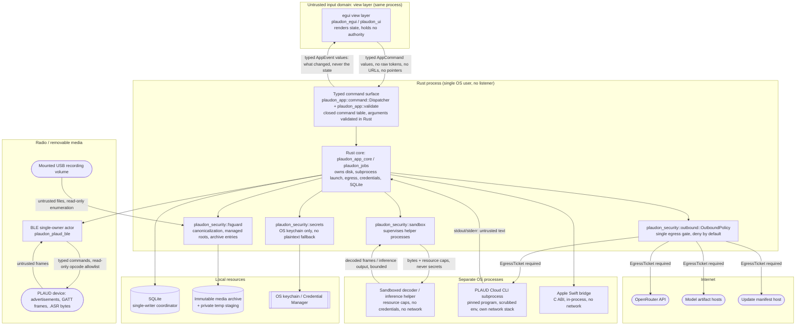

# Trust and process boundaries

Source: SPEC v1.3 §6.2, §6.3 (invariants 5, 7, 8, 12, 13, 14, 15), §6.3A,
§15.1 and Appendix B.4/B.7. Row ids refer to
[`traceability.json`](traceability.json); unresolved items are in
[`open-findings.md`](open-findings.md).

The Rust core is the only trusted decision point. Everything on the other side
of a boundary below — including our own user interface, which since the egui
cutover runs in the same process — is treated as an input
domain to be validated, not as a caller to be believed.

## Boundary diagram

## Boundaries in detail

### B1. egui view layer ↔ the typed command surface

This boundary used to be an IPC one: a React webview invoked Tauri commands
across a process-internal channel the OS could see. At the EPIC O cutover
(ADR-0024) the webview, the capability manifest and the IPC channel were
deleted; the view layer is now Rust in the same process. **The boundary did not
move, and it did not weaken.** It is still the line where untrusted input meets
authority, because the view layer is written against the same assumption: it
renders state and sends commands, and it holds no capability of its own.

* **Crosses inward:** `plaudon_app::command::AppCommand` values —
  typed requests with primitive arguments and opaque ids — handed to
  `Dispatcher::send`, which returns a `CommandId` and never blocks the frame.
* **Crosses outward:** `plaudon_app::event::AppEvent` values on a bounded,
  coalescing channel: a §15.3 `UiEvent` saying *what changed*, a typed command
  outcome, or an instruction to resynchronise. An event never carries the state
  itself; the view refetches through another command.
* **Validated by:** `plaudon_app::validate`, which every dispatch arm calls
  before a port is touched, exactly as the Tauri command wrappers did (§6.3A),
  and `plaudon_security::fsguard` for anything path-shaped. The closed surface
  is structural rather than audited: the enums, `COMMAND_NAMES` and the dispatch
  arms are generated from one table in `crates/app/src/command.rs`, so a command
  cannot reach the dispatcher without appearing in the published list, and no
  generic-execution name (`exec…`, `run_…`, `shell…`, `http_…`, `read_file`,
  `write_file`) is representable.
* **Explicitly not trusted:** every argument, including ones a screen
  "already validated"; any path string; any id the view claims to own. Being in
  the same address space is not an argument for believing it — a rendering bug
  that produces a malformed id must fail validation, not reach a port.
* **Never crosses outward:** bearer tokens, signed download URLs, device
  secrets, filesystem-wide handles or capabilities, platform-bridge pointers
  (§6.3A). The properties the webview rules used to carry — no remotely hosted
  UI content, no shell plugin, no devtools in a production build — are now
  properties of the artifact rather than of a manifest: there is no browser
  engine to host remote content and no scriptable surface at all, and the
  "not debuggable, no runtime-protection escape hatch" half is enforced by the
  packaging entitlement and manifest audits (TM-039).
* **One honest limit of an in-process boundary.** A webview was also a process
  and address-space boundary of sorts; the view layer is not. A memory-safety
  defect in view code is a defect in the trusted process. What limits that is
  the language, not containment: the screens in `crates/ui` contain no `unsafe`
  at all, and the `unsafe` the shell does carry is confined to platform
  interop in `apps/plaudon-egui` — the status item's `Send`/`Sync` assertions
  and the macOS open-URL delegate — none of which parses untrusted input.
* **Error envelopes:** a security failure crosses this boundary only through
  `plaudon_security::domain_map`, which maps it onto the closed
  `plaudon_domain::error::AppErrorCode` set. The user-facing message is chosen
  by the domain code; the security layer's specific reason travels in
  `AppError::detail`, which is never shown to the user or carried into an
  event. That split is what keeps §15.4's "no signed URLs, credentials, raw
  request bodies or transcript excerpts in an envelope" true by construction
  rather than by review (TM-010, TM-042).

### B2. Rust core ↔ SQLite (single-writer coordinator)

* **Crosses:** typed statements from one writer; a bounded reader pool.
* **Validated by:** the persistence layer's migration runner and schema
  constraints (EPIC B); the core never interpolates user text into SQL.
* **Explicitly not trusted:** nothing on this boundary is remote, but the
  *contents* are attacker-influenced (titles, transcripts), so they are never
  treated as commands, paths or shell arguments downstream.
* **Invariant:** credentials are never stored here — only opaque references and
  fingerprints (§16.4, TM-034).

### B3. Rust core ↔ immutable media archive + private temp staging

* **Crosses:** staged copies of imported bytes; checksummed commits; reads for
  playback and decoding.
* **Validated by:** `plaudon_security::fsguard` — canonicalize at the boundary,
  confine to managed roots, private temp directories, restrictive permissions,
  reject traversing or absolute archive entries (TM-022, TM-037, TM-038).
* **Explicitly not trusted:** any path that originated outside the core; any
  entry name inside a backup archive; the claimed size of an archive entry.
* **Invariant:** import is copy-only. A source file outside the archive is
  never moved, rewritten or deleted (§6.3 invariant 11, TM-018).

### B4. Rust core ↔ OS keychain / Credential Manager

* **Crosses:** service/account-scoped get, set and delete calls; secret values
  held transiently in zeroizing buffers.
* **Validated by:** `plaudon_security::secrets`.
* **Explicitly not trusted:** the availability of the store. A locked or
  unavailable store yields an actionable locked state, never a plaintext
  fallback (ADR-0014, TM-033).
* **Invariant:** one entry per device; no universal token shared across devices
  (TM-034).

### B5. Rust core ↔ PLAUD Cloud CLI subprocess

* **Crosses outward:** a pinned program path
  (`plaudon_security::outbound::subprocess::PLAUD_CLI_PROGRAM`), a fixed list of
  typed `CliArg` values, and a scrubbed environment.
* **Crosses inward:** stdout and stderr — **untrusted text**.
* **Validated by:** `plaudon_security::outbound::subprocess::GatedProcessLauncher`
  (launch requires an `EgressTicket`, so Local-only Mode cannot launch it at
  all) and, for the parsing side, `plaudon_source_plaud_cli` (EPIC K).
* **Explicitly not trusted:** the CLI's own network behaviour. It is a separate
  executable with its own stack, which is exactly why §16.2A forbids running it
  in Local-only Mode rather than trying to constrain it (TM-027).
* **Explicitly not trusted:** stdout as a data format — enumeration output is
  parsed defensively with bounded allocation, and a signed URL inside it is
  ephemeral and never logged (TM-010).

### B6. Rust core ↔ Apple Swift bridge

* **Crosses:** a narrow C ABI with owned buffers and explicit lifetimes; a
  runtime availability probe before any call.
* **Validated by:** the bridge crate's ABI safety wrapper (`crates/ai-apple`,
  `native/apple-bridge`, EPIC H).
* **Explicitly not trusted:** availability. Absence of the framework or the
  on-device model must degrade gracefully, not crash (§11.5).
* **Invariant:** the bridge gets audio and text, never credentials, and it is
  not a network path.

### B7. Rust core ↔ BLE single-owner actor ↔ device radio

* **Crosses outward:** typed commands from exactly one owner; opcodes
  restricted to a compile-time read-only allowlist (discovery, auth, list,
  read). Delete, clear, settings-write, OTA and cloud-sync opcodes are not
  representable in the import path (§6.3 invariant 14, App. B.6).
* **Crosses inward:** advertisements, GATT notifications, framed chunks,
  claimed file sizes and ids — all untrusted.
* **Validated by:** `plaudon_plaud_protocol` (length, opcode, framing and
  offset coherence with bounded allocation) and `plaudon_plaud_ble` (session
  ownership, timeouts, reconnect identity revalidation).
* **Explicitly not trusted:** the advertised local name or manufacturer data as
  an authorization signal (TM-003); an empty delta list as proof the device is
  empty (TM-008); any claimed length as an allocation size.
* **Honest limit:** the legacy profile is unauthenticated at the radio layer.
  No validation on this boundary adds confidentiality to the link
  (App. B.5, TM-002).

### B8. Rust core ↔ sandboxed decoder / inference helper

* **Crosses outward:** a file descriptor or byte range plus resource caps. No
  credentials, no keychain handle, no egress ticket.
* **Crosses inward:** decoded frames or inference output, bounded in size and
  time.
* **Validated by:** `plaudon_security::sandbox` — OS process sandboxing where
  available, CPU/wall-clock/memory caps, length-prefixed IPC framing with a
  bounded frame size, and a kill path whose result is a failed job (never a
  completed import).
* **Explicitly not trusted:** the helper itself. A crash, a hang or an OOM is
  an expected outcome, not an incident (ADR-0015, TM-012).
* **Honest limit, per platform — do not generalise:** the supervisor reports
  the isolation it actually applied, and `IsolationReport::notes` carries the
  applicable `plaudon_security::sandbox::NOTE_*` constants at run time.
  * **macOS** (verified on macOS 26, arm64): filesystem, network and `exec`
    are restricted by a generated deny-by-default Seatbelt profile run through
    `/usr/bin/sandbox-exec`. Apple has deprecated that primitive; it is probed
    at every launch and the report degrades to
    `ReducedIsolation{PrimitiveUnavailable}` the moment it stops working. The
    durable replacement is a separately signed, entitled helper under the App
    Sandbox, which is not implemented.
  * **macOS memory:** there is no hard kernel memory cap. The kernel rejects
    `RLIMIT_AS`/`RLIMIT_DATA` below the address space the dyld shared cache
    reserves, so the cap is enforced by the parent sampling the child's
    resident set every 20 ms and terminating it on breach — real enforcement,
    with a sampling delay. CPU and wall clock use `RLIMIT_CPU` plus a
    parent-side monotonic deadline.
  * **Windows:** a real job object (process memory limit, one active process,
    kill-on-job-close, job time, basic UI restrictions). The helper is
    assigned to the job immediately after creation rather than created
    suspended; no untrusted work happens in that window because the helper
    does nothing before its first IPC frame and the parent sends that frame
    only after assignment. There is **no** filesystem or network restriction
    in V1 — no restricted token, no AppContainer — and the report says
    `ReducedIsolation{PrimitiveUnavailable}` for those dimensions.
  * **Other unix:** POSIX resource limits only; filesystem, network and `exec`
    are reported `ReducedIsolation{PlatformUnsupported}`. Landlock is
    deliberately not claimed.
* **Residual risk:** kernel vulnerabilities, the input and output files the
  helper is legitimately granted, and anything outside this process. The
  sandbox is per-helper and says nothing about other processes on the machine.

### B9. Rust core ↔ internet (the single egress gate)

* **Crosses outward:** only requests that carry an `EgressTicket` minted by
  `OutboundPolicy::authorize`, which no other module can construct.
* **Validated by:** `plaudon_security::outbound` — mode (Local-only by
  default), subsystem/purpose coherence, payload class, https-only destinations
  with no credentials or IP literals, host allowlist, explicit approval for
  model downloads and telemetry. Every decision, allow or deny, is recorded
  (TM-007, TM-026, ADR-0013).
* **Crosses inward:** HTTP responses — untrusted bytes, validated against
  typed contracts and JSON Schema before use (EPIC G).
* **Explicitly not trusted:** response bodies, redirect targets, provider claims
  about retention (§16.6).
* **Honest limit:** the gate governs traffic this process initiates through our
  transports. See the not-guaranteed list in [`README.md`](README.md).

## Untrusted input domains (§6.3A)

Every domain SPEC §6.3A names, with the module that validates it. `status`
mirrors the matrix: `planned` means the validating module is not implemented in
this repository yet, and the owning epic is named rather than the row being
dropped.

| # | Untrusted input domain | Validating boundary (module) | Status | Rows |
|---|---|---|---|---|
| 1 | The view layer: command arguments, ids, paths, anything a screen "already validated" | `plaudon_app::command` (a closed, generated command table with no generic-execution name) and `plaudon_app::validate` (every argument, before any port), then `plaudon_security::fsguard` for anything path-shaped | implemented — EPIC D for the path core, EPIC O for the typed surface that replaced the IPC allowlist | TM-016, TM-037 |
| 2 | Local audio files chosen by the user (manual import) | `plaudon_security::fsguard` (canonical path, managed roots) → `plaudon_audio::sniff` (content-based format detection, never the extension) → `plaudon_security::sandbox` (decode out of process) | implemented — fsguard/sandbox EPIC D; planned — sniff EPIC F | TM-012, TM-037 |
| 3 | Vendor audio files from a mounted USB recording volume and from a watched folder | `plaudon_security::fsguard` (read-only enumeration, expected volume structure, no trust in the volume label) → `plaudon_source_folder` readiness probe and copy-only staging → `plaudon_audio::sniff` → `plaudon_security::sandbox` | implemented — fsguard/sandbox EPIC D; planned — watcher EPIC K, sniff EPIC F | TM-012, TM-018, TM-037 |
| 4 | PLAUD BLE advertisements, GATT notifications and framed `.ASR` chunks | `plaudon_plaud_protocol` (bounded parsing, opcode and offset coherence) inside the `plaudon_plaud_ble` single-owner actor | planned — EPIC L | TM-003, TM-004, TM-005, TM-006, TM-008 |
| 5 | PLAUD Cloud CLI stdout and stderr | launch side `plaudon_security::outbound::subprocess` (pinned program, typed args, scrubbed env, ticket required); parse side `plaudon_source_plaud_cli` (bounded enumeration parser, ephemeral signed URLs) | implemented (launch side) / planned — EPIC K (parse side) | TM-009, TM-010, TM-019, TM-027 |
| 6 | Downloaded model files | `plaudon_security::outbound` (model download is a distinct purpose requiring explicit approval, https-only allowlisted host) → model manager checksum and license verification before first use → `plaudon_security::sandbox` at inference time | implemented — egress gate and sandbox EPIC D; planned — EPIC F (artifact verification) | TM-011, TM-012, TM-013 |
| 7 | OpenRouter responses (transcription, completion, model catalog) | `plaudon_security::outbound` (destination, purpose, payload class, allowlist) → `plaudon_ai_contracts` typed contracts and JSON Schema validation → `plaudon_ai_tools` treats transcript and model text as data, never instructions | implemented (egress side) / planned — EPIC G (typed responses), EPIC I (grounding) | TM-011, TM-014, TM-015, TM-025 |
| 8 | Imported backups / portable archives | `plaudon_security::fsguard` (archive entry path and size bounds, no traversal, no absolute entries, decompression limits) → `plaudon_export` restore (checksum and schema verification, secret exclusion) | implemented — entry validation EPIC D; planned — EPIC J (restore) | TM-022, TM-037 |

### Domains that are not inputs

* **No inbound network surface exists.** There is no HTTP listener, no local
  control socket, no webhook endpoint and no remote callback (§6.3 invariant
  12). Local automation invokes the same validated Rust services as the GUI
  through the OS user's own permissions (§6.3 invariant 13, TM-021).
* **The view layer is not a privilege domain.** It holds no capability the
  application layer does not re-check per command, and the cutover to an
  in-process user interface did not change that: the commands it may send are a
  closed generated list, and every argument is validated in Rust before a port
  sees it.
